<div align="center">

# 📚 Bookstore Inventory & Analytics System

### A Python-powered bookstore management and sales-insights project

<p>
  
  
  
  
  
</p>

<p><strong>Manage books · Track stock · Record sales · Analyze revenue · Visualize trends</strong></p>

</div>

---

## 🧭 Contents

- [Project at a Glance](#-project-at-a-glance)
- [Project Overview](#-project-overview)
- [Problem Statement](#-problem-statement)
- [Objectives](#-objectives)
- [Features](#-features)
- [Technology Stack](#-technology-stack)
- [Project Structure](#-project-structure)
- [Datasets and Columns](#-datasets-and-columns)
- [How the Application Works](#-how-the-application-works)
- [Menu Options: Detailed Guide](#-menu-options-detailed-guide)
- [Data Cleaning and Validation](#-data-cleaning-and-validation)
- [Reports and Analytics](#-reports-and-analytics)
- [Visualizations Explained](#-visualizations-explained)
- [Python Concepts and Definitions](#-python-concepts-and-definitions)
- [Installation and Setup](#-installation-and-setup)
- [Sample Console Output](#-sample-console-output)
- [Output Gallery: All Screenshots](#-output-gallery-all-screenshots)
- [Important Rules and Limitations](#-important-rules-and-limitations)
- [Troubleshooting](#-troubleshooting)
- [Learning Outcomes](#-learning-outcomes)
- [Possible Future Improvements](#-possible-future-improvements)
- [Author](#-author)

---

## 📌 Project at a Glance

| Item | Details |
|---|---|
| Project name | Bookstore Inventory and Analytics System |
| Application type | Menu-driven command-line application |
| Programming language | Python 3 |
| Main program | `bookstore_system.py` |
| Inventory dataset | `inventory.csv` |
| Sales dataset | `sales.csv` |
| Main class | `Bookstore` |
| Data-processing libraries | Pandas and NumPy |
| Chart libraries | Matplotlib and Seaborn |
| Storage | CSV files |
| Database / API | Not used |
| User interface | Text-based terminal menu |

> **Purpose:** This project combines everyday bookstore stock management with sales reporting, data cleaning, numerical calculations, and graphical analysis in one Python application.

## 📖 Project Overview

The **Bookstore Inventory and Analytics System** is a Python application for maintaining a catalogue of books and recording book sales. It can display the current inventory, add or remove books, update stock quantities, record a sale, calculate summary metrics, analyze sales by book/genre/author/month, and draw charts from the sales dataset.

The project reads and writes two CSV files:

- `inventory.csv` stores book details and the quantity currently in stock.
- `sales.csv` stores dated sales transactions and the revenue associated with each transaction.

Pandas is used to load, clean, transform, group, and save tabular data. NumPy is used for numerical validation and calculations. Matplotlib and Seaborn are used to create sales charts.

The program is designed for learning and demonstration. It is a local console project, not a deployed commercial point-of-sale platform.

## 🎯 Problem Statement

A bookstore needs a simple way to maintain its catalogue and stock levels while understanding how its books are selling. Managing these tasks manually can make it difficult to notice invalid records, calculate revenue consistently, find top-selling books, or compare sales across genres and months.

This project addresses those needs through a menu-driven program that:

1. Loads book and sales data from CSV files.
2. removes exact duplicate rows during loading and validates selected fields.
3. supports common inventory operations.
4. records sales while checking stock availability.
5. calculates basic business metrics and grouped summaries.
6. visualizes sales patterns with charts.

## 🥅 Objectives

- Practise Python classes, objects, methods, loops, and conditional statements.
- Work with CSV datasets using Pandas.
- validate numeric input and handle invalid values safely.
- Demonstrate file existence checks and saving data back to CSV.
- Calculate inventory value and sales revenue.
- Summarize sales by title, genre, author, and month.
- Create bar, line, pie, and correlation heatmap visualizations.
- Display understandable messages for common validation and stock errors.

## ✨ Features

| Feature | What it does |
|---|---|
| View inventory | Prints the cleaned inventory table in the terminal. |
| Add a book | Adds a new title after checking required text fields, price, quantity, and duplicate titles. |
| Remove a book | Removes a title from the inventory using a case-insensitive title match. |
| Update stock | Changes the quantity of an existing book. |
| Record a sale | Checks the title and available stock, records the transaction, and reduces inventory quantity. |
| Generate report | Shows title count, copies in stock, inventory value, sales revenue, average price, and best-selling title when available. |
| Analyze sales | Summarizes copies sold and revenue by book, genre, and author, then shows monthly revenue and a latest-month growth calculation when possible. |
| Show visualizations | Displays sales-by-genre, monthly revenue, genre revenue share, and a price/quantity correlation heatmap when the data supports them. |
| Save data | Writes current inventory and sales data to their CSV files. |
| Exit safely | Saves the data before ending the program. |

---

## 🧰 Technology Stack

| Technology | Definition | Use in this project |
|---|---|---|
| **Python 3** | A general-purpose programming language. | Application logic, menu, methods, validation, and calculations. |
| **Pandas** | A Python library for working with labelled/tabular data. | Reads CSV files into DataFrames, cleans rows, groups sales, and writes CSV files. |
| **NumPy** | A numerical computing library for Python. | Checks finite numeric values and calculates sums, means, and numeric arrays. |
| **Matplotlib** | A plotting library for Python. | Creates and displays figures. |
| **Seaborn** | A statistical visualization library built on Matplotlib. | Styles charts, creates bar and line plots, and draws a correlation heatmap. |
| **CSV** | Comma-separated values, a plain-text tabular file format. | Stores inventory and sales records between program runs. |

### Why these libraries?

- **Pandas** makes it convenient to process rows and columns, handle missing values, remove duplicates, and create grouped reports.
- **NumPy** provides numeric operations and the `isfinite()` check used by input validation.
- **Matplotlib** provides the figure and chart display system.
- **Seaborn** provides high-level statistical plotting functions and a consistent chart theme.

## 🗂️ Project Structure

```text
Bookstore_inventory_analytics_project/
│
├── bookstore_system.py     # Main Python application
├── inventory.csv           # Book catalogue and stock quantities
├── sales.csv               # Historical sales transactions
├── README.md               # Project documentation
│
└── assets/
    ├── Output1.png
    ├── Output2.png
    ├── Output3.png
    ├── Output4.png
    ├── Output5.png
    ├── Output6.png
    ├── Output7.png
    ├── Output8.png
    ├── Output9.png
    ├── Output10.png
    ├── Output11.png
    ├── Output12.png
    └── Output13.png
```

### File-by-file definition

- **`bookstore_system.py`** — contains the `Bookstore` class, validation helper, menu loop, inventory functions, sales logic, reporting, and chart generation.
- **`inventory.csv`** — contains the current book catalogue. The quantity in this file represents available stock.
- **`sales.csv`** — contains transaction history. Each row represents a recorded sale, with its date, book details, quantity, price, and revenue.
- **`README.md`** — explains the project, setup, features, concepts, and screenshots.
- **`assets/Output1.png` to `Output13.png`** — screenshots supplied with the project, showing code examples, terminal results, and generated charts.

The application expects the CSV files to be in the current working directory, or to be reachable through the filenames passed to `Bookstore`.

## 🧾 Datasets and Columns

### 1. `inventory.csv`

| Column | Meaning | Validation / handling in the program |
|---|---|---|
| `Book ID` | Identifier associated with a book. | Missing values are converted to empty strings during loading. |
| `Title` | Book title. | Missing values become empty text; whitespace is stripped; rows with empty titles are removed. |
| `Author` | Author name. | Missing values become `Unknown`; whitespace is stripped. |
| `Genre` | Book category, such as Fiction or Self-Help. | Missing values become `Unknown`; whitespace is stripped. |
| `Price` | Price of one copy. | Converted to numeric; invalid or missing values and values not greater than zero are excluded during loading. |
| `Quantity` | Number of copies currently in stock. | Converted to numeric; invalid or missing values and negative quantities are excluded; valid values are converted to integers. |

**Inventory cleaning sequence:** ensure expected columns exist → keep the expected column order → remove exact duplicate rows → normalize text fields → convert price and quantity to numeric → discard invalid rows → remove repeated titles while keeping the first occurrence.

### 2. `sales.csv`

| Column | Meaning | Validation / handling in the program |
|---|---|---|
| `Date` | Date on which the sale occurred. | Converted to a Pandas datetime value; invalid dates are excluded. |
| `Title` | Title sold. | Missing values become empty text; whitespace is stripped; empty titles are excluded. |
| `Author` | Author of the book sold. | Missing values become `Unknown`; whitespace is stripped. |
| `Genre` | Genre of the book sold. | Missing values become `Unknown`; whitespace is stripped. |
| `Quantity Sold` | Number of copies sold in the transaction. | Converted to numeric; missing/invalid values and values not greater than zero are excluded. |
| `Price` | Unit price stored for the transaction. | Converted to numeric; missing/invalid values and values not greater than zero are excluded. |
| `Total Revenue` | Revenue associated with the transaction. | Converted to numeric; if missing, it is filled with `Quantity Sold × Price`. |

**Sales cleaning sequence:** ensure expected columns exist → keep the expected column order → remove exact duplicate rows → parse dates and numeric fields → normalize text fields → exclude rows without valid date, quantity, or price → calculate missing revenue → reset the row index.

### Data quality note

The loader can handle missing or malformed values according to the rules above. However, the CSV files currently included in this ZIP are the provided project datasets; their exact contents may change after the application saves cleaned data or records new transactions. The application cleans data **in memory when it loads** and writes changes when `save_data()` runs, when menu option `9` is selected, or when the user exits normally through option `0`.

## 🔄 How the Application Works

1. Python runs `main()` when `bookstore_system.py` is executed directly.
2. `main()` creates a `Bookstore` object.
3. The constructor loads and cleans the inventory and sales CSV files.
4. The program displays the main menu repeatedly.
5. The user selects a menu option by entering its number.
6. The matching method performs the requested operation.
7. Methods that change data call `save_data()` to persist the changes.
8. The loop continues until the user selects `0` to save and exit.

```text
Start
  │
  ▼
Create Bookstore object
  │
  ▼
Load and clean inventory.csv and sales.csv
  │
  ▼
Display menu ───────────────────────┐
  │                                 │
  ▼                                 │
Read user's choice                  │
  │                                 │
  ├─ 1: Show inventory              │
  ├─ 2: Add a book                  │
  ├─ 3: Remove a book               │
  ├─ 4: Update stock                │
  ├─ 5: Record a sale               │
  ├─ 6: Generate report             │
  ├─ 7: Analyze sales               │
  ├─ 8: Show charts                 │
  ├─ 9: Save data                   │
  └─ 0: Save and exit               │
                                    └── Repeat menu
```

## 🖥️ Menu Options: Detailed Guide

The menu displayed by the supplied code is:

```text
BOOKSTORE INVENTORY AND ANALYTICS SYSTEM
1. Show inventory
2. Add a book
3. Remove a book
4. Update book stock
5. Record a sale
6. Generate report
7. Analyze sales
8. Show visualizations
9. Save data
0. Exit
Enter your choice:
```

### Option 1 — Show inventory

Calls `show_inventory()`.

- If the inventory DataFrame has no rows, the program prints `Inventory is empty.`
- Otherwise, it prints a heading and the inventory table using `to_string(index=False)`.
- `index=False` means Pandas does not print the DataFrame's row index.

### Option 2 — Add a book

Prompts for title, author, genre, price, and quantity, then calls `add_book()`.

Validation performed:

1. Title, author, and genre must not be empty.
2. Price must be a finite number greater than zero.
3. Quantity must be a whole number greater than or equal to zero.
4. A title that already exists is rejected using a case-insensitive comparison.
5. A new numeric ID is chosen as one greater than the highest numeric ID found, where possible.
6. The new row is added and saved.

Example interaction:

```text
Enter your choice: 2
Enter book title: Example Book
Enter author: Example Author
Enter genre: Fiction
Enter positive price: 250
Enter quantity (0 or more): 10
Book added successfully.
```

The example values above illustrate the input format; they are not a claim that this exact transaction appears in the supplied screenshots.

### Option 3 — Remove a book

Prompts for a title and calls `remove_book(title)`.

- Title matching is case-insensitive and ignores surrounding whitespace.
- If no matching title exists, the program prints `Book not found.`
- If the title exists, the matching row is removed, the index is reset, and the data is saved.

**Important:** this removes the book from the current inventory catalogue. It does not delete historical rows for that title from `sales.csv`.

### Option 4 — Update book stock

Prompts for a title and new quantity, then calls `update_inventory(title, quantity)`.

- Quantity must be a whole number greater than or equal to zero.
- The title must exist in the inventory.
- The stock quantity is updated and saved.
- A quantity of zero is allowed and means no copies are currently available.

### Option 5 — Record a sale

Prompts for the title and number of copies sold, then calls `record_sale(title, quantity_sold)`.

The method:

1. Validates the sale quantity as a positive whole number.
2. Finds the book using a case-insensitive title match.
3. checks whether the requested quantity is greater than current stock.
4. Calculates `revenue = unit price × quantity sold`.
5. Adds a transaction to the sales DataFrame using today's date.
6. Reduces inventory quantity by the number sold.
7. Saves both datasets and prints a success message and sale revenue.

Possible messages include:

```text
Book not found.
Insufficient stock.
Sale recorded successfully!
Revenue from this sale: 500.00
```

The revenue value shown is only an illustrative example. A real result depends on the book price and quantity entered.

### Option 6 — Generate report

Calls `generate_report()` and prints:

- number of book titles in the current inventory,
- total copies in stock,
- total inventory value (`Price × Quantity` summed across books),
- total sales revenue from `Total Revenue`,
- average book price,
- best-selling book by total copies sold, if sales exist.

If there are no sales records, the best-selling result is `No sales recorded.` If there are no inventory rows, the average price is displayed as `0.00`.

### Option 7 — Analyze sales

Calls `analyze_sales()`.

It prints four groups of analysis:

1. **Sales by book:** total copies sold and revenue for each title.
2. **Sales by genre:** total copies sold and revenue for each genre.
3. **Sales by author:** total copies sold and revenue for each author.
4. **Monthly revenue:** total revenue grouped by calendar month.

When at least two monthly revenue values are available and the previous month's revenue is not zero, the method calculates the latest month-over-month percentage change:

`((latest month revenue − previous month revenue) / abs(previous month revenue)) × 100`

Otherwise, it prints that there is not enough monthly data to calculate sales growth.

### Option 8 — Show visualizations

Calls `visualize()` and opens the available charts one after another. The method first checks whether sales data exists. Chart availability also depends on the number and validity of the records.

See [Visualizations Explained](#-visualizations-explained) for definitions and interpretation.

### Option 9 — Save data

Calls `save_data()` to write inventory and sales DataFrames to their CSV files and prints `Data saved.`

The sales dates are formatted as `YYYY-MM-DD` before the sales CSV is written.

### Option 0 — Exit

Saves data, prints a thank-you message, and exits the loop.

### Invalid menu choice

If the input is not one of `0` through `9`, the program prints:

```text
Invalid choice. Please enter a number from 0 to 9.
```

## 🧹 Data Cleaning and Validation

Data cleaning helps prevent incorrect or inconsistent records from interfering with reports.

### 1. Required columns

The loader defines the expected column names for each dataset. If a column is missing from a CSV file, it is added with missing values before the expected columns are selected. This allows the loader to work with files that lack one or more expected columns, although rows without the required usable data can still be discarded.

### 2. Duplicate removal

`drop_duplicates()` removes exact duplicate rows. Inventory loading also uses `drop_duplicates(subset=["Title"], keep="first")`, so only the first cleaned occurrence of a title remains in inventory.

### 3. Text normalization

- `fillna("")` replaces missing titles with empty strings before validation.
- `fillna("Unknown")` supplies a placeholder for missing authors and genres.
- `astype(str)` converts the values to strings.
- `str.strip()` removes leading and trailing whitespace.
- `str.casefold()` supports case-insensitive title comparisons.

### 4. Numeric conversion

`pd.to_numeric(..., errors="coerce")` converts valid values to numbers and turns unconvertible values into missing values (`NaN`). The loader then removes rows that do not satisfy the required conditions.

### 5. Date conversion

`pd.to_datetime(..., errors="coerce")` parses valid dates and turns invalid date strings into `NaT`, which are then excluded from sales data.

### 6. Input validation helper: `_positive_number()`

The static method `_positive_number(value, label, allow_zero=False, whole=False)`:

1. attempts to convert the supplied value to `float`;
2. reports an error if it is not numeric;
3. uses `np.isfinite()` to reject infinity and `NaN`;
4. rejects negative numbers and, by default, zero;
5. if `whole=True`, rejects values that are not whole numbers;
6. returns an integer for whole-number inputs or a float otherwise.

The method returns `None` after invalid input, allowing the calling method to stop without making a change.

| Example input | Example use | Expected validation result |
|---|---|---|
| `"250"` | Price | Accepted as `250.0` |
| `"-5"` | Price | Rejected because it is negative |
| `"2.5"` | Quantity with `whole=True` | Rejected because it is not a whole number |
| `"0"` | Quantity with `allow_zero=True, whole=True` | Accepted as `0` |
| `"abc"` | Numeric field | Rejected because it is not numeric |

### 7. Revenue calculation

For a newly recorded sale, the program uses:

```python
revenue = float(book["Price"]) * quantity_sold
```

When loading sales data, `Total Revenue` is calculated from quantity and price only for rows where that field is missing. A pre-existing non-missing revenue value is retained by the loader.

## 📊 Reports and Analytics

### Inventory value

The inventory value estimates the value of the copies currently held in stock:

`Inventory Value = Σ (Book Price × Quantity in Stock)`

It is not the same as total sales revenue.

### Total sales revenue

The report adds the values in `sales["Total Revenue"]`. This is transaction revenue stored in the sales dataset, not the value of current stock.

### Average book price

The program calculates the arithmetic mean of the prices in the cleaned inventory:

`Average Book Price = Sum of inventory prices / Number of inventory titles`

### Best-selling book

The sales dataset is grouped by `Title`, and `Quantity Sold` is summed. The title with the largest total is displayed as the best-selling book.

### Sales by genre and author

Grouping by `Genre` or `Author` lets the program compare the number of copies sold and revenue associated with each group. The printed summaries are sorted in descending order by copies sold or revenue, depending on the report.

### Monthly revenue trend

The sales date is converted into a calendar month using Pandas periods. Revenue is summed by month and sorted chronologically. The monthly summary is also used by the line chart and the month-over-month growth calculation.

## 📈 Visualizations Explained

The supplied code can produce up to four chart types. The screenshots below are the actual output images included in the ZIP; their appearance and displayed values depend on the datasets and execution state used when they were captured.

### 1. Bar chart — Total Copies Sold by Genre

**Function:** `visualize()`  
**Library:** Seaborn (`sns.barplot`) with Matplotlib

- **X-axis:** Genre.
- **Y-axis:** Total copies sold.
- **Purpose:** Compare sales volume between genres.
- **How to read it:** Taller bars indicate more copies sold for that genre.
- **Code logic:** The sales rows are grouped by genre and `Quantity Sold` is summed; the results are sorted from highest to lowest before plotting.

### 2. Line chart — Monthly Sales Revenue Trend

**Function:** `visualize()`  
**Library:** Seaborn (`sns.lineplot`)

- **X-axis:** Month.
- **Y-axis:** Revenue.
- **Purpose:** Observe how recorded revenue changes across months.
- **How to read it:** Upward sections indicate an increase in revenue from one plotted month to the next; downward sections indicate a decrease.
- **Code logic:** `Total Revenue` is summed by month, then plotted in month order with markers.

### 3. Pie chart — Revenue Share by Genre

**Function:** `visualize()`  
**Library:** Matplotlib (`plt.pie`)

- **Slices:** Genres.
- **Values:** Total revenue for each genre.
- **Labels:** Genre names.
- **Percentages:** Each slice's share of the plotted genre revenue.
- **Purpose:** Compare the composition of revenue across genres.
- **Condition:** The chart is created only if the summed genre revenue is greater than zero.

### 4. Heatmap — Correlation: Book Price vs Quantity Sold

**Function:** `visualize()`  
**Library:** Seaborn (`sns.heatmap`)

- **Variables:** `Price` and `Quantity Sold`.
- **Cells:** Correlation coefficients between the numeric columns.
- **Scale:** Values range from `-1` to `1` in the configured color scale.
- **Purpose:** Explore whether price and quantity sold move together in this dataset.
- **Condition:** At least two valid rows are needed.
- **Interpretation caution:** Correlation does not prove that price causes a change in sales. The chart only describes the relationship in the available records.

---

## 🧠 Python Concepts and Definitions

| Concept | Definition | Where it appears |
|---|---|---|
| **Class** | A blueprint that groups related data and behaviour. | `class Bookstore:` |
| **Object / instance** | A particular object created from a class. | `store = Bookstore()` |
| **Constructor** | The initializer called when an object is created. | `__init__()` |
| **Instance attributes** | Values stored on an object using `self`. | `self.inventory_file`, `self.sales_file`, `self.inventory`, `self.sales` |
| **Method** | A function defined inside a class. | `add_book()`, `record_sale()`, `generate_report()` |
| **Static method** | A method that does not need an instance or class argument. | `@staticmethod` on `_positive_number()` |
| **Function** | A reusable block of code. | `get_text()` and `main()` |
| **Loop** | Repeats a block of code. | `while True` keeps the menu running. |
| **Conditional statement** | Selects code to run based on a condition. | `if` / `elif` menu branches and validation checks. |
| **Exception handling** | Manages errors that occur during execution. | `try` / `except` in numeric conversion. |
| **File existence check** | Checks whether a path exists. | `os.path.exists()` before loading a CSV. |
| **CSV reading** | Loads a CSV file into tabular data. | `pd.read_csv()` |
| **CSV writing** | Saves tabular data to a CSV file. | `DataFrame.to_csv()` |
| **DataFrame** | A two-dimensional labelled data structure from Pandas. | `self.inventory`, `self.sales` |
| **Missing-value handling** | Replaces or removes missing data. | `fillna()`, `notna()`, `dropna()` |
| **Duplicate removal** | Removes repeated rows or repeated titles. | `drop_duplicates()` |
| **Type conversion** | Converts values to another data type. | `pd.to_numeric()`, `pd.to_datetime()`, `astype()` |
| **Aggregation** | Combines multiple records into summary values. | `groupby()`, `sum()`, `mean()` |
| **NumPy array** | An array structure for numerical operations. | `to_numpy(dtype=float)` |
| **String normalization** | Cleans or standardizes text for comparison. | `strip()`, `lower()`, `casefold()` |
| **Date/time processing** | Represents dates and extracts calendar periods. | `pd.to_datetime()`, `dt.to_period("M")`, `pd.Timestamp.today()` |
| **Data visualization** | Represents data visually to help reveal patterns. | Bar, line, pie, and heatmap charts. |
| **Formatted output** | Displays a value with a chosen format. | `f"{revenue:.2f}"` displays two decimal places. |

### Main class method reference

| Method | Responsibility |
|---|---|
| `__init__()` | Stores CSV filenames and loads both datasets. |
| `_positive_number()` | Validates numeric input and optionally enforces whole numbers or allows zero. |
| `_load_inventory()` | Creates the inventory file if missing, loads it, and cleans its data. |
| `_load_sales()` | Creates the sales file if missing, loads it, and cleans its data. |
| `save_data()` | Writes the current inventory and sales data to CSV files. |
| `show_inventory()` | Displays the inventory table or an empty-inventory message. |
| `add_book()` | Validates and adds a new inventory title. |
| `remove_book()` | Removes a title from inventory. |
| `update_inventory()` | Updates the stock quantity for a title. |
| `record_sale()` | Validates and records a sale, calculates revenue, and reduces stock. |
| `generate_report()` | Calculates and prints summary metrics. |
| `analyze_sales()` | Prints grouped sales summaries and monthly revenue. |
| `visualize()` | Produces the available sales charts. |
| `get_text()` | Reads user input and strips surrounding whitespace. |
| `main()` | Creates the store object and controls the menu loop. |

## ⚙️ Installation and Setup

### Requirements

- Python 3
- NumPy
- Pandas
- Matplotlib
- Seaborn

### Step 1 — Install or verify Python

Check that Python 3 is available:

```bash
python3 --version
```

On some Windows installations, use:

```bash
python --version
```

### Step 2 — Extract the project

Extract `Bookstore_inventory_analytics_project.zip`. Open a terminal in the extracted `Bookstore_inventory_analytics_project` folder.

Confirm the main files are together:

```text
bookstore_system.py
inventory.csv
sales.csv
README.md
```

### Step 3 — Install dependencies

On macOS or Linux:

```bash
python3 -m pip install numpy pandas matplotlib seaborn
```

On Windows:

```bash
python -m pip install numpy pandas matplotlib seaborn
```

If `pip` is not found, try invoking it through Python as shown above. If Python itself is not found, install Python 3 and ensure it is available on your terminal's PATH.

### Step 4 — Run the program

macOS / Linux:

```bash
python3 bookstore_system.py
```

Windows:

```bash
python bookstore_system.py
```

### Step 5 — Use the menu

Enter a number from `0` to `9` when prompted. To finish, select `0`; the program saves data before exiting.

### Optional — Run in an IDE

You can open the folder in VS Code, PyCharm, IDLE, or another Python editor. Run `bookstore_system.py` in the IDE's terminal or console so you can enter menu responses and see printed results.

## 🧪 Sample Console Output

The following is an illustrative format based on the program's print statements. Actual counts, prices, and revenue depend on the CSV data at the time of execution.

### Inventory

```text
--- BOOK INVENTORY ---
Book ID  Title             Author         Genre       Price  Quantity
1        Atomic Habits     James Clear    Self-Help   661.54 1
2        The Alchemist     Paulo Coelho   Fiction     743.24 31
```

### Report

```text
--- BOOKSTORE REPORT ---
Number of books/titles: <current title count>
Total copies in stock: <current copy count>
Inventory value: <calculated inventory value>
Total sales revenue: <sum of sales revenue>
Average book price: <average inventory price>
Best-selling book: <title> (<copies> copies)
```

### Sale

```text
Sale recorded successfully!
Revenue from this sale: <unit price multiplied by quantity sold>
```

### Validation and stock messages

```text
Price must be numeric.
Price must be a finite number.
Price must be positive.
Quantity must be a whole number.
This book already exists. Use Update Inventory to change its stock.
Book not found.
Insufficient stock.
```

These messages are generated by validation and operation checks in the supplied Python code. The placeholder values in angle brackets above are descriptions, not literal output.

## 🖼️ Output Gallery: All Screenshots

All 13 output images from the provided ZIP are included below. Click an image to open the full-size file in GitHub.

<div align="center">

### Output 1 — Numeric validation helper

<a href="assets/Output1.png">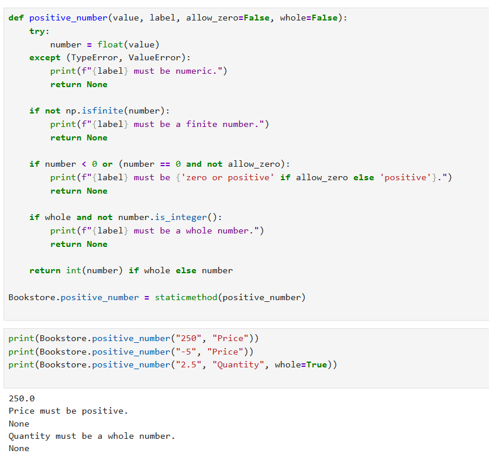</a>

Shows the `_positive_number()` helper and example checks for valid and invalid numeric values.

---

### Output 2 — Save data method

<a href="assets/Output2.png">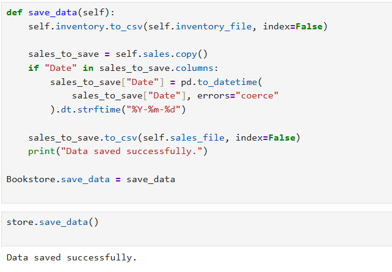</a>

Shows the CSV save logic and a save operation result.

---

### Output 3 — Display inventory

<a href="assets/Output3.png">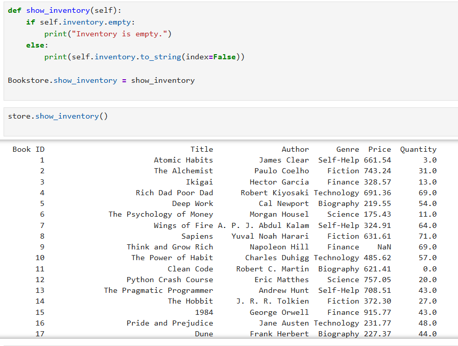</a>

Shows the inventory display method and a sample table of book records.

---

### Output 4 — Add a book

<a href="assets/Output4.png">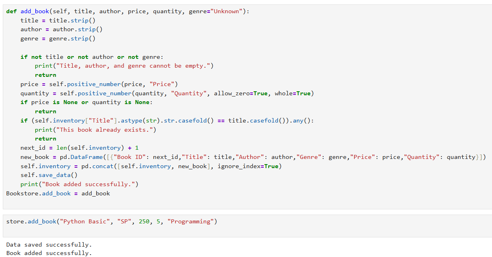</a>

Shows the add-book validation and the result of adding a book.

---

### Output 5 — Remove a book

<a href="assets/Output5.png">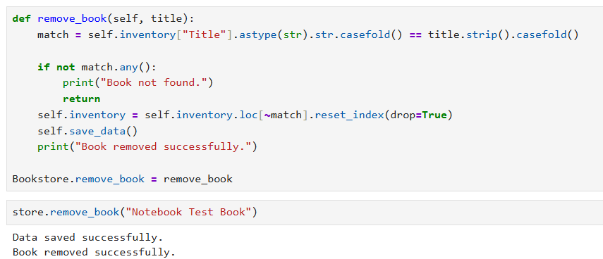</a>

Shows title matching, removal from inventory, and the resulting success messages.

---

### Output 6 — Update stock

<a href="assets/Output6.png">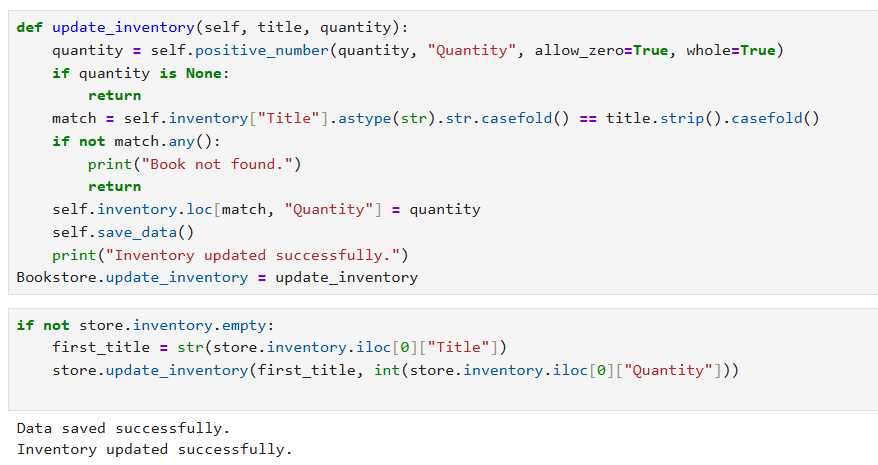</a>

Shows quantity validation and stock update behaviour.

---

### Output 7 — Record a sale

<a href="assets/Output7.png">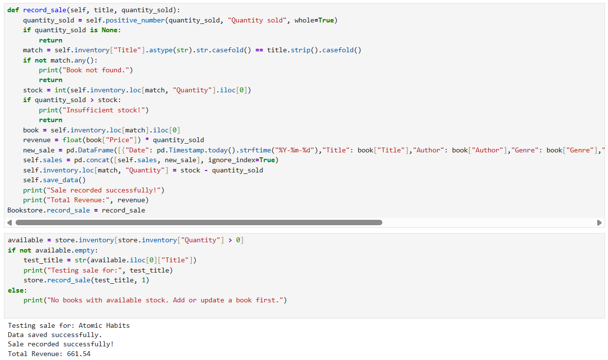</a>

Shows sale validation, stock checking, revenue calculation, and a sample sale result.

---

### Output 8 — Generate report

<a href="assets/Output8.png">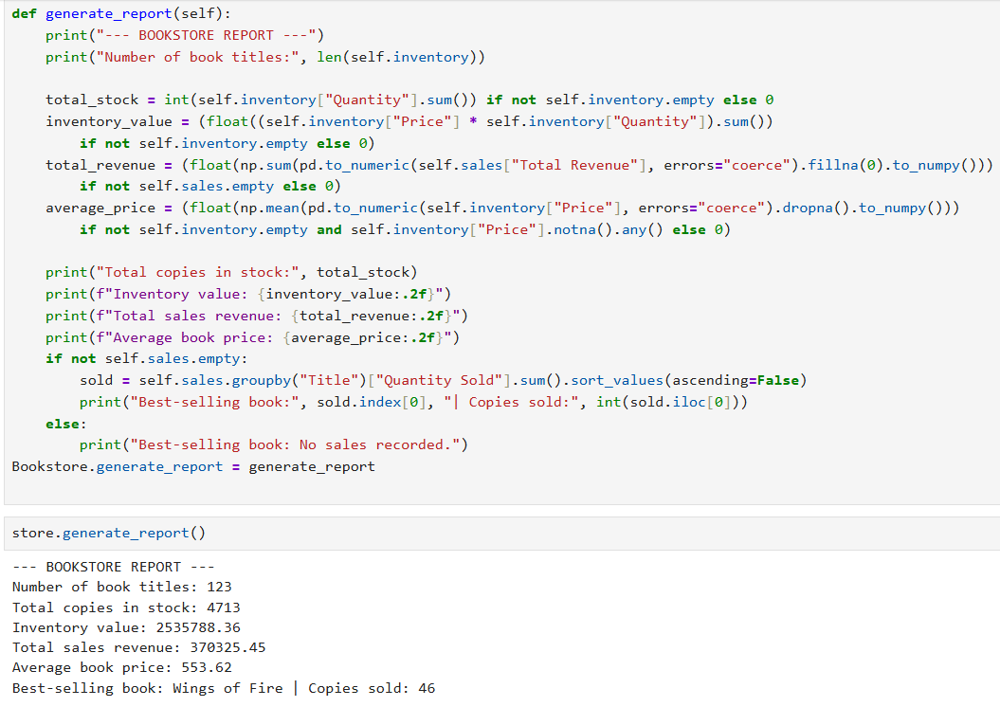</a>

Shows the report method and the summary values printed by the program.

---

### Output 9 — Analyze sales by book and genre

<a href="assets/Output9.png">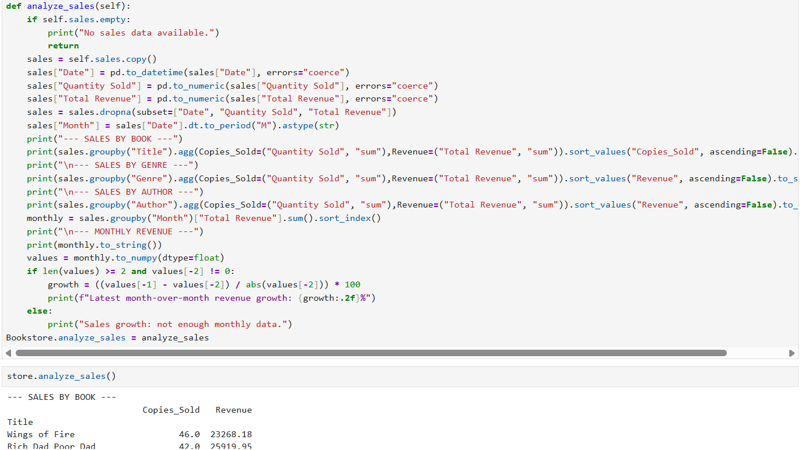</a>

Shows the grouped sales analysis logic and the beginning of the report output.

---

### Output 10 — Analyze sales by author and month

<a href="assets/Output10.png">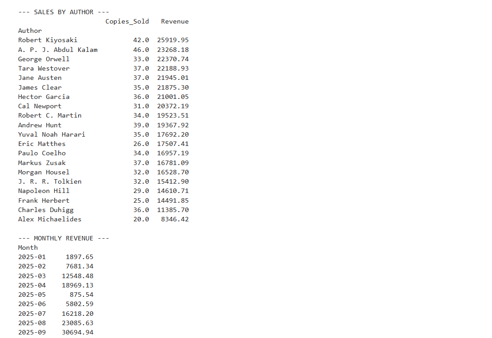</a>

Shows the author-level summary and monthly revenue output.

---

### Output 11 — Visualization logic

<a href="assets/Output11.png">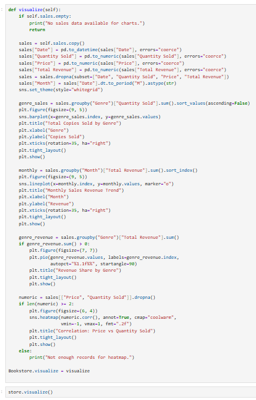</a>

Shows the code that prepares the data and creates the charts.

---

### Output 12 — Bar chart and monthly revenue line chart

<a href="assets/Output12.png">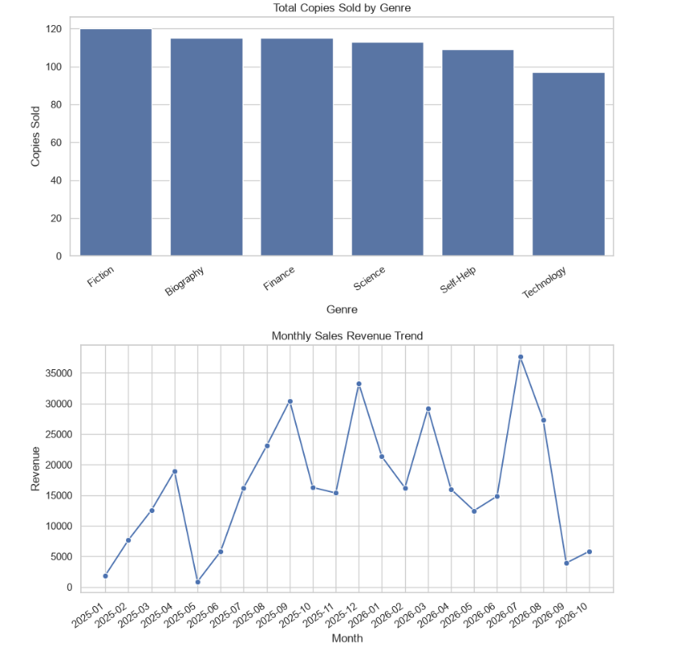</a>

Shows the **Total Copies Sold by Genre** bar chart and the **Monthly Sales Revenue Trend** line chart.

---

### Output 13 — Revenue pie chart and correlation heatmap

<a href="assets/Output13.png">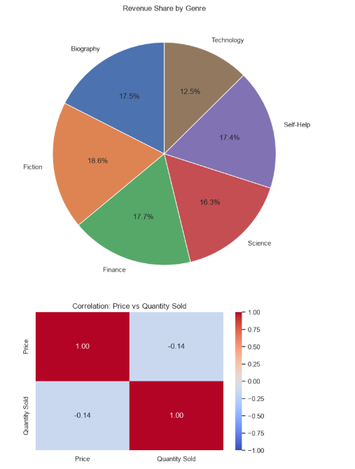</a>

Shows the **Revenue Share by Genre** pie chart and the **Correlation: Book Price vs Quantity Sold** heatmap.

</div>

## ⚠️ Important Rules and Limitations

- Prices must be finite numbers greater than zero when adding a book.
- Sale quantity must be a positive whole number.
- Inventory stock may be zero but cannot be negative.
- A sale cannot exceed the available quantity for the selected title.
- Duplicate inventory titles are rejected during adding, ignoring letter case.
- The application matches titles without case sensitivity for add/remove/update/sale operations.
- The CSV files are the persistence layer; there is no SQL or cloud database.
- `save_data()` writes the current in-memory DataFrames. Changes are saved automatically by the add, remove, update, and record-sale methods, as well as by menu option `9` and normal exit option `0`.
- Loading cleans the data in memory. A read-only report or chart does not itself save those cleaned DataFrames unless a save operation is subsequently performed.
- Inventory and sales are separate datasets. Removing an inventory title does not remove its past sales history.
- The charts are based on sales data, not inventory stock. The heatmap describes correlation, not causation.
- The application has no graphical user interface, login, role permissions, payment integration, or multi-user synchronization.

## 🛠️ Troubleshooting

| Problem | What to check |
|---|---|
| `python3: command not found` | Install Python 3 or use the command available on your operating system, such as `python`. |
| `No module named pandas` | Install dependencies using `python3 -m pip install numpy pandas matplotlib seaborn` (or `python -m pip` on Windows). |
| CSV file not found | Run the script from the project folder, or check the file names and working directory. The program creates a missing CSV with the expected headers. |
| `Inventory is empty.` | Check whether inventory rows are present and valid. Rows with blank titles or invalid/missing price or quantity are discarded during loading. |
| `No sales data available for analysis.` | Check that `sales.csv` contains valid rows with a parseable date, title, positive quantity, and positive price. |
| Chart does not appear | Run the program in a local terminal or IDE that supports Matplotlib windows. Check that valid sales rows are loaded. |
| Sale rejected with `Insufficient stock.` | Reduce the quantity sold or update stock before recording the sale. |
| A title appears more than once in the source CSV | Inventory loading keeps the first cleaned occurrence of each title. |

## 🎓 Learning Outcomes

After exploring this project, a learner should be able to explain and practise:

- Defining classes and creating objects.
- Writing reusable methods and standalone functions.
- Building a menu-driven application with loops and conditions.
- Reading and writing CSV files.
- Cleaning missing, duplicate, malformed, and inconsistent values.
- Converting columns into numeric and datetime types.
- Validating numbers, including finite values and whole-number quantities.
- Updating related data consistently when a sale is recorded.
- Calculating revenue, stock totals, averages, and inventory value.
- Grouping records and sorting summaries with Pandas.
- Using NumPy for numerical calculations.
- Creating and interpreting bar charts, line charts, pie charts, and correlation heatmaps.
- Explaining common input errors and the limits of a local file-based system.

## 🚀 Possible Future Improvements

These are ideas for later versions; they are **not features currently implemented**:

- [ ] Add a search-books menu option.
- [ ] Add low-stock alerts.
- [ ] Add a date-range filter for sales reports.
- [ ] Export reports to Excel or PDF.
- [ ] Add unit tests for inventory and sales methods.
- [ ] Add a GUI using Tkinter or a web interface.
- [ ] Add backup and restore for CSV files.
- [ ] Add a dedicated transaction ID to each sale.
- [ ] Add configurable currency formatting.
- [ ] Add stricter checks to reconcile a transaction's price with the current inventory price.
- [ ] Add logging for audit and troubleshooting purposes.

## 👨‍💻 Author

<div align="center">

### **Sujal Patel**

**Python · Data Processing · Object-Oriented Programming · Data Visualization**

This project demonstrates practical Python programming through inventory management, sales tracking, CSV data handling, analytical reporting, and visual exploration of sales data.

</div>

---

<div align="center">

### 📚 Bookstore Inventory & Analytics System

**Manage books • Record sales • Discover insights**

[⬆ Back to top](#-bookstore-inventory--analytics-system)

</div>
