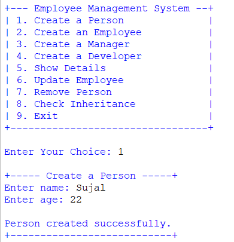
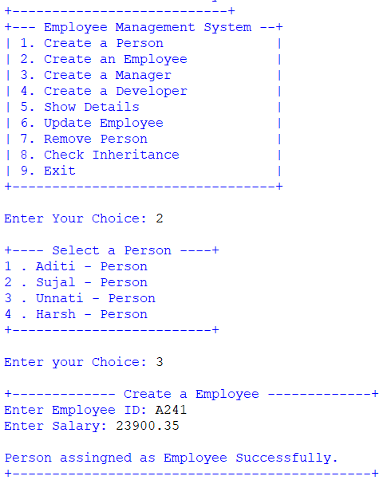
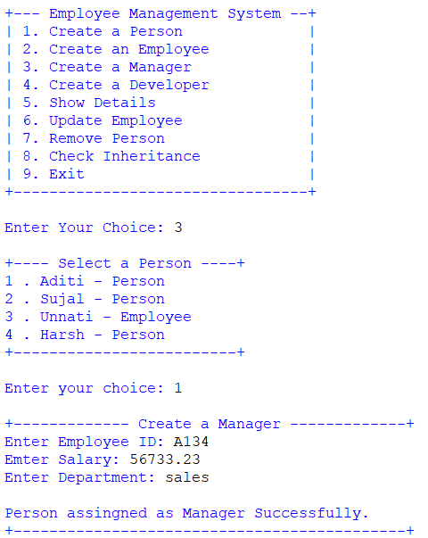
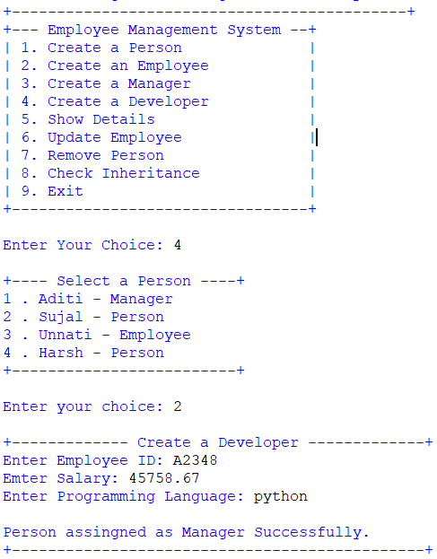
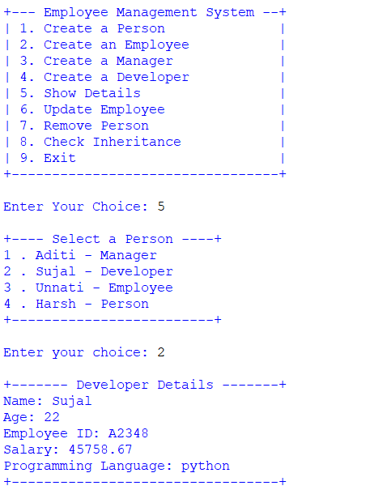
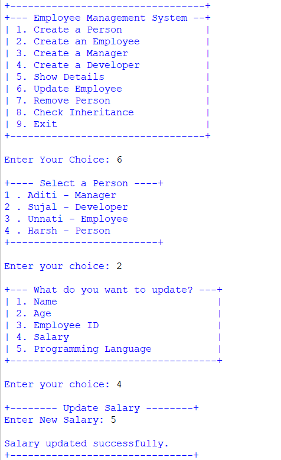
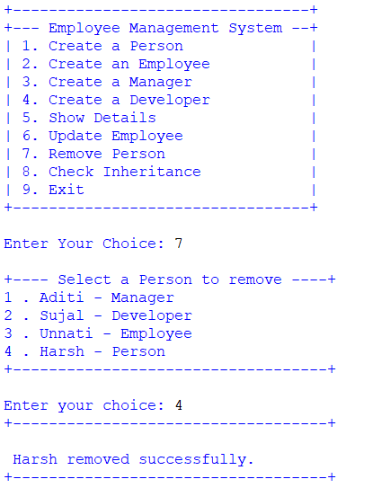
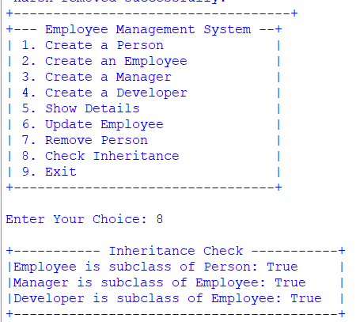
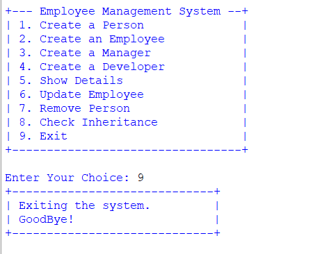

<div align="center">

# 👨‍💼 Employee Management System

### Python OOP-Based Employee Management Console Application

<p>
A menu-driven Python application designed to demonstrate
<strong>Object-Oriented Programming (OOP)</strong> concepts through
Person, Employee, Manager, and Developer classes.
</p>

<br>


<br><br>

**Create → Assign Role → Display → Update → Remove → Check Inheritance**

</div>

---

## 📌 Project Overview

**Employee Management System** is a Python console-based application created to practice and demonstrate core **Object-Oriented Programming concepts**.

The program manages different types of people using the following class hierarchy:

```text
Person
  │
  └── Employee
        ├── Manager
        └── Developer
```

The application allows users to:

- Create a Person
- Assign a Person as an Employee
- Assign a Person as a Manager
- Assign a Person as a Developer
- Display details
- Update information
- Remove a Person
- Check inheritance relationships
- Exit the application

---

## ✨ Features

| Option | Feature | Concept |
|:---:|:---|:---|
| 1 | Create a Person | Class & Object |
| 2 | Create an Employee | Inheritance |
| 3 | Create a Manager | Multilevel Inheritance |
| 4 | Create a Developer | Multilevel Inheritance |
| 5 | Show Details | Method Overriding |
| 6 | Update Employee | Encapsulation |
| 7 | Remove Person | List Operations |
| 8 | Check Inheritance | `issubclass()` |
| 9 | Exit | Program Control |

---

## 🖥️ Main Menu

```text
+--- Employee Management System --+
| 1. Create a Person              |
| 2. Create an Employee           |
| 3. Create a Manager             |
| 4. Create a Developer           |
| 5. Show Details                 |
| 6. Update Employee              |
| 7. Remove Person                |
| 8. Check Inheritance            |
| 9. Exit                         |
+---------------------------------+

Enter Your Choice:
```

The menu runs continuously using a `while True` loop until the user selects option `9`.

---

## 👤 1. Create a Person

Creates a basic `Person` object.

### Person Attributes

- Name
- Age
- Role

```python
self.role = "Person"
```

### Example

```text
+----- Create a Person -----+
Enter name: Sujal
Enter age: 22

Person created successfully.
+---------------------------+
```

---

## 👨‍💼 2. Create an Employee

An existing Person can be assigned as an Employee.

The `Employee` class inherits from `Person`.

```python
class Employee(Person):
```

### Employee Attributes

- Name
- Age
- Employee ID
- Salary
- Role

The parent constructor is called using:

```python
super().__init__(name, age)
```

### Example

```text
+---- Select a Person ----+
1 . Sujal - Person
+-------------------------+

Enter your Choice: 1

+------------- Create a Employee -------------+
Enter Employee ID: EMP101
Enter Salary: 30000

Person assigned as Employee successfully.
+---------------------------------------------+
```

---

## 👔 3. Create a Manager

An existing Person can be assigned as a Manager.

The `Manager` class inherits from `Employee`.

```python
class Manager(Employee):
```

### Manager Attributes

- Name
- Age
- Employee ID
- Salary
- Department
- Role

### Example

```text
+------------- Create a Manager -------------+
Enter Employee ID: MGR101
Enter Salary: 50000
Enter Department: IT

Person assigned as Manager successfully.
+--------------------------------------------+
```

---

## 👨‍💻 4. Create a Developer

An existing Person can be assigned as a Developer.

The `Developer` class inherits from `Employee`.

```python
class Developer(Employee):
```

### Developer Attributes

- Name
- Age
- Employee ID
- Salary
- Programming Language
- Role

### Example

```text
+------------- Create a Developer -------------+
Enter Employee ID: DEV101
Enter Salary: 45000
Enter Programming Language: Python

Person assigned as Developer successfully.
+----------------------------------------------+
```

---

## 📋 5. Show Details

Option `5` displays details of the selected person.

Each class has its own `display()` method.

This demonstrates **Method Overriding**.

### Example

```text
+----- Employee Details -----+
Name: Sujal
Age: 22
Employee ID: EMP101
Salary: 30000.0
+----------------------------+
```

---

## ✏️ 6. Update Employee

The application allows users to update information.

### Common Fields

```text
1. Name
2. Age
```

### Employee / Manager / Developer

```text
3. Employee ID
4. Salary
```

### Manager

```text
5. Department
```

### Developer

```text
5. Programming Language
```

The program uses setter methods:

```python
person.set_name(new_name)
person.set_age(new_age)
person.set_employee_id(new_id)
person.set_salary(new_salary)
```

Manager:

```python
person.set_department(new_department)
```

Developer:

```python
person.set_programming_language(new_language)
```

---

## 🔐 Encapsulation

The `Employee` class contains private attributes:

```python
self.__employee_id = employee_id
self.__salary = salary
```

These values are accessed through getter and setter methods.

### Employee ID

```python
def get_employee_id(self):
    return self.__employee_id

def set_employee_id(self, employee_id):
    self.__employee_id = employee_id
```

### Salary

```python
def get_salary(self):
    return self.__salary

def set_salary(self, salary):
    self.__salary = salary
```

This demonstrates **Encapsulation** in Python.

---

## 🧬 Inheritance Structure

```text
                ┌──────────────┐
                │    Person    │
                └──────┬───────┘
                       │
                       ▼
                ┌──────────────┐
                │   Employee   │
                └──────┬───────┘
                       │
              ┌────────┴────────┐
              ▼                 ▼
        ┌───────────┐     ┌───────────┐
        │  Manager  │     │ Developer │
        └───────────┘     └───────────┘
```

### Classes

```python
class Employee(Person):
    pass
```

```python
class Manager(Employee):
    pass
```

```python
class Developer(Employee):
    pass
```

### Relationship

```text
Employee  → Person
Manager   → Employee → Person
Developer → Employee → Person
```

---

## 🔍 8. Check Inheritance

Option `8` uses Python's `issubclass()` function.

```python
issubclass(Employee, Person)
issubclass(Manager, Employee)
issubclass(Developer, Employee)
```

### Example Output

```text
+----------- Inheritance Check -----------+
| Employee is subclass of Person: True   |
| Manager is subclass of Employee: True  |
| Developer is subclass of Employee: True|
+-----------------------------------------+
```

---

## 🗑️ 7. Remove Person

The selected person can be removed from the `persons` list.

```python
persons.pop(person_choice - 1)
```

### Example

```text
+---- Select a Person to remove ----+
1 . Sujal - Developer
+-----------------------------------+

Enter your choice: 1

Sujal removed successfully.
```

---

## 🚪 9. Exit

Selecting option `9` exits the application.

```text
+-----------------------------+
| Exiting the system.         |
| Goodbye!                    |
+-----------------------------+
```

The program exits the `while` loop using:

```python
break
```

---

## 🧩 Class Overview

| Class | Inherits From | Responsibility |
|:---|:---|:---|
| `Person` | — | Basic person information |
| `Employee` | `Person` | Employee ID and Salary |
| `Manager` | `Employee` | Department |
| `Developer` | `Employee` | Programming Language |

---

## 🔧 Method Overview

### Person

| Method | Purpose |
|:---|:---|
| `__init__()` | Initialize name, age, and role |
| `set_name()` | Update name |
| `set_age()` | Update age |
| `display()` | Display person details |

### Employee

| Method | Purpose |
|:---|:---|
| `__init__()` | Initialize employee information |
| `get_employee_id()` | Get Employee ID |
| `set_employee_id()` | Update Employee ID |
| `get_salary()` | Get salary |
| `set_salary()` | Update salary |
| `display()` | Display employee details |

### Manager

| Method | Purpose |
|:---|:---|
| `__init__()` | Initialize manager information |
| `set_department()` | Update department |
| `display()` | Display manager details |

### Developer

| Method | Purpose |
|:---|:---|
| `__init__()` | Initialize developer information |
| `set_programming_language()` | Update programming language |
| `display()` | Display developer details |

---

## 🧠 Python Concepts Demonstrated

| Concept | Usage |
|:---|:---|
| Classes | `Person`, `Employee`, `Manager`, `Developer` |
| Objects | Class instances |
| Constructor | `__init__()` |
| Inheritance | `Employee → Person` |
| Multilevel Inheritance | `Manager/Developer → Employee → Person` |
| Encapsulation | Private attributes |
| Getter | `get_employee_id()`, `get_salary()` |
| Setter | `set_name()`, `set_age()`, etc. |
| Method Overriding | `display()` |
| `super()` | Parent constructor |
| `issubclass()` | Inheritance checking |
| Lists | Store objects |
| `while` Loop | Main menu |
| `for` Loop | Display people |
| Conditional Statements | Menu control |
| `input()` | User input |
| Type Conversion | `int()` and `float()` |

---

## 📦 Data Structure

The application stores objects in a list:

```python
persons = []
```

### Add

```python
persons.append(person)
```

### Replace

```python
persons[index] = employee
```

### Remove

```python
persons.pop(person_choice - 1)
```

---

## 🔄 Program Workflow

```text
START
  │
  ▼
Display Main Menu
  │
  ▼
User Selects Option
  │
  ├── Create Person
  ├── Create Employee
  ├── Create Manager
  ├── Create Developer
  ├── Show Details
  ├── Update Employee
  ├── Remove Person
  ├── Check Inheritance
  └── Exit
         │
         ▼
        END
```

---

# 📂 Project Structure

```text
📦 Employee-Management-System
│
├── 🐍 main.py
├── 📘 README.md
│
└── 📂 assets
    ├── 🖼️ Output1.png
    ├── 🖼️ Output2.png
    ├── 🖼️ Output3.png
    ├── 🖼️ Output4.png
    ├── 🖼️ Output5.png
    ├── 🖼️ Output6.png
    ├── 🖼️ Output7.png
    ├── 🖼️ Output8.png
    ├── 🖼️ Output9.png
    └── 🎥 Project Demonstration.mp4
```

---

# 📸 Output Gallery

<div align="center">

<table width="100%">

<tr>

<td width="50%" valign="top" align="center">

### 👤 Create Person

<a href="assets/Output1.png">

</a>

</td>

<td width="50%" valign="top" align="center">

### 👨‍💼 Create Employee

<a href="assets/Output2.png">

</a>

</td>

</tr>

<tr>

<td width="50%" valign="top" align="center">

### 👔 Create Manager

<a href="assets/Output3.png">

</a>

</td>

<td width="50%" valign="top" align="center">

### 👨‍💻 Create Developer

<a href="assets/Output4.png">

</a>

</td>

</tr>

<tr>

<td width="50%" valign="top" align="center">

### 📋 Show Details

<a href="assets/Output5.png">

</a>

</td>

<td width="50%" valign="top" align="center">

### ✏️ Update Employee

<a href="assets/Output6.png">

</a>

</td>

</tr>

<tr>

<td width="50%" valign="top" align="center">

### 🗑️ Remove Person

<a href="assets/Output7.png">

</a>

</td>

<td width="50%" valign="top" align="center">

### 🔍 Inheritance Check

<a href="assets/Output8.png">

</a>

</td>

</tr>

<tr>

<td width="50%" valign="top" align="center">

### 🚪 Program Exit

<a href="assets/Output9.png">

</a>

</td>

<td width="50%" valign="top" align="center">

</td>

</tr>

</table>

</div>

---

# 🎥 Project Demonstration

<div align="center">

## ▶️ See The Complete Project In Action

The project demonstration video shows the complete workflow of the **Employee Management System**.

### 📋 Demonstration Includes

```text
01  ▶ Create a Person
02  ▶ Create an Employee
03  ▶ Create a Manager
04  ▶ Create a Developer
05  ▶ Show Details
06  ▶ Update Employee Information
07  ▶ Remove Person
08  ▶ Check Inheritance
09  ▶ Exit the Application
```

### 🎬 Watch the Demonstration

**[▶️ Open Project Demonstration Video](assets/Project%20Demonstration.mp4)**

</div>

> [!TIP]
> If GitHub does not preview the MP4 directly, click the link above to open the demonstration video.

### 🎥 Demonstration File

```text
assets/
└── Project Demonstration.mp4
```

---

# 🚀 How To Run

### 1. Install Python

Install Python 3.x and verify:

```bash
python --version
```

### 2. Open the Project

Open the project in:

```text
VS Code
PyCharm
IDLE
Any Python IDE
```

### 3. Open Terminal

```bash
cd Employee-Management-System
```

### 4. Run the Program

```bash
python main.py
```

---

# 📦 Requirements

```text
🐍 Python 3.x
```

No external packages are required.

```text
External Libraries → None
Database → None
API → None
Framework → None
```

---

# ⚠️ Program Notes

### Person Must Exist First

Options `2`, `3`, and `4` require an existing Person.

If no Person exists:

```text
No person found.
```

### Role-Based Updates

```text
Employee  → Employee ID + Salary
Manager   → Employee ID + Salary + Department
Developer → Employee ID + Salary + Programming Language
```

---

# 🎯 Learning Outcomes

This project provides practical experience with:

```text
✓ Object-Oriented Programming
✓ Classes and Objects
✓ Constructors
✓ Inheritance
✓ Multilevel Inheritance
✓ Encapsulation
✓ Private Attributes
✓ Getters and Setters
✓ Method Overriding
✓ super()
✓ issubclass()
✓ Lists of Objects
✓ Loops
✓ Conditional Statements
✓ User Input
✓ Menu-Driven Programs
```

---

# 🚧 Future Improvements

- [ ] Add input validation
- [ ] Add exception handling
- [ ] Add employee search
- [ ] Add employee ID uniqueness checking
- [ ] Add salary validation
- [ ] Add delete confirmation
- [ ] Add sorting employees by salary
- [ ] Add filtering by role
- [ ] Add employee count by role
- [ ] Save employee data to a file
- [ ] Add JSON/CSV storage
- [ ] Add database support
- [ ] Add GUI version

---

# 📊 Project Snapshot

<div align="center">

| Category | Details |
|:---|:---|
| 🏷️ Project | Employee Management System |
| 🐍 Language | Python 3.x |
| 💻 Type | Console Application |
| 🧠 Main Topic | Object-Oriented Programming |
| 👤 Base Class | `Person` |
| 👨‍💼 Employee Class | `Employee` |
| 👔 Manager Class | `Manager` |
| 👨‍💻 Developer Class | `Developer` |
| 🔗 Inheritance | Multilevel |
| 🔐 Encapsulation | Implemented |
| 📦 External Packages | None |
| 🖼️ Output Images | 9 |
| 🎥 Demonstration | Included |

</div>

---

# 🧑‍💻 Author

<div align="center">

## **Sujal Patel**

### Python Developer / Learner

**Python • OOP • Inheritance • Encapsulation • Problem Solving**

This project was developed as a practical implementation of Python
Object-Oriented Programming concepts, including classes, objects,
inheritance, encapsulation, method overriding, getters, setters,
and menu-driven program design.

</div>

---

# 📄 License

This project is created for **educational and learning purposes**.

---

<div align="center">

# 👨‍💼 Employee Management System

### **Create • Manage • Update • Understand OOP**

<br>

🐍 **Developed by Sujal Patel**

<br>

⭐ **Explore • Learn • Code • Improve**

<br><br>

<a href="#-employee-management-system">⬆ Back to Top</a>

</div>
