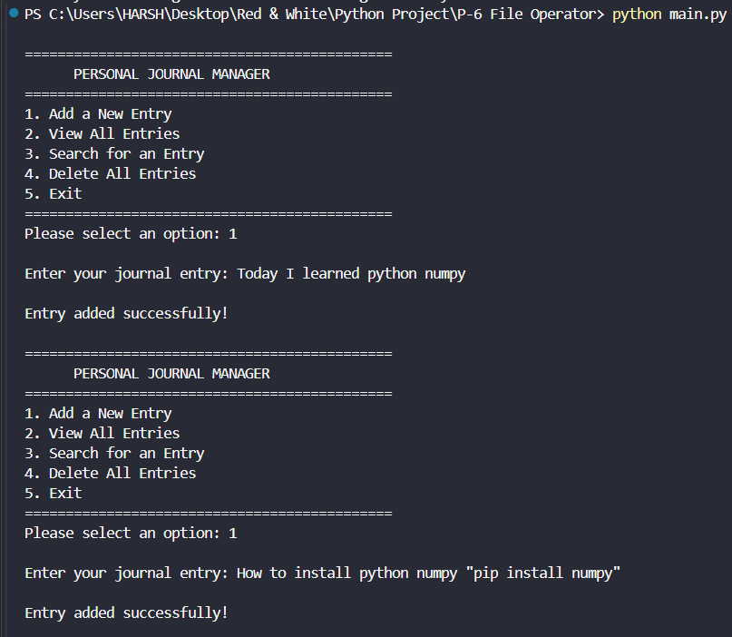
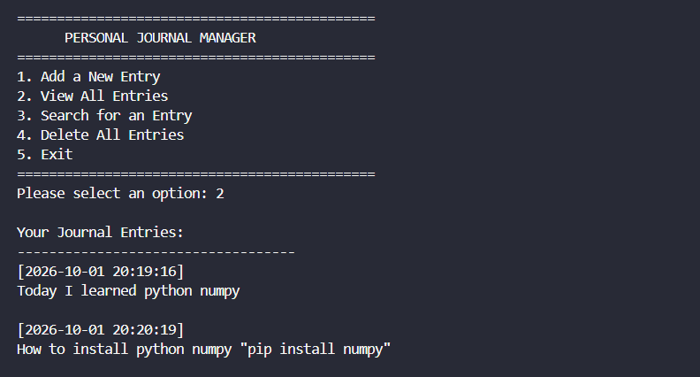
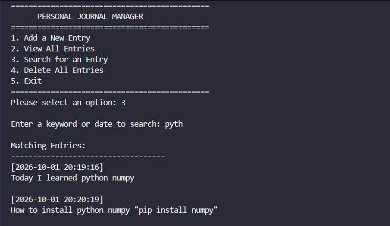
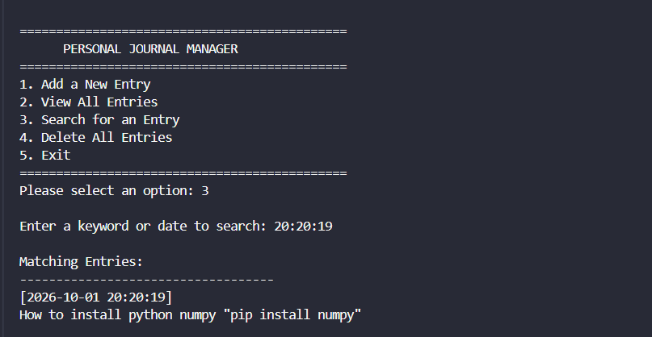
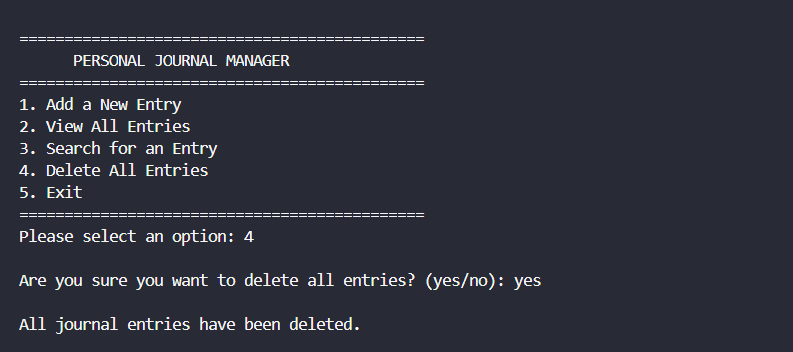
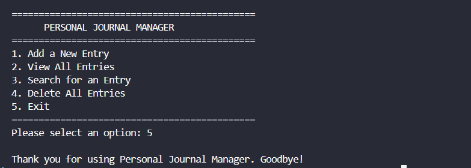

<div align="center">

# 📔 File Operator

### Python File Handling-Based Personal Journal Manager

<p>
A menu-driven Python console application designed to demonstrate
<strong>file handling</strong>, <strong>object-oriented programming</strong>,
<strong>exception handling</strong>, and practical text-file operations
through a simple Personal Journal Manager.
</p>

<p>


</p>

<br>

**Create → Add → View → Search → Delete → Manage Files**

</div>

---

# 📌 Project Overview

**File Operator** is a Python console-based Personal Journal Manager that allows users to create and manage journal entries using a text file.

The project demonstrates practical Python **file handling modes**, including:

- `a` — Append new journal entries
- `r` — Read existing journal entries
- `w` — Write/clear file contents
- `x` — Create a new file only if it does not already exist

Each journal entry is stored with a timestamp so users can keep track of when an entry was created.

The program also uses exception handling to gracefully manage file-related errors such as missing files, permission problems, and operating-system errors.

---

# ✨ Features

| Option | Feature | Main Concept |
|:---:|:---|:---|
| 1 | Add a New Entry | Append Mode `a` |
| 2 | View All Entries | Read Mode `r` |
| 3 | Search for an Entry | File Reading & String Search |
| 4 | Delete All Entries | File Operations & `os.remove()` |
| 5 | Exit | Program Control |

### Additional File Demonstration

The program also includes a `demonstrate_create_mode()` method to demonstrate **exclusive creation mode `x`**.

---

# 🖥️ Main Menu

```text
+------------------------------------+
|      PERSONAL JOURNAL MANAGER      |
+------------------------------------+
|1. Add a New Entry                  |
|2. View All Entries                 |
|3. Search for an Entry              |
|4. Delete All Entries               |
|5. Exit                             |
+------------------------------------+
Please select an option:
```

The menu runs continuously using a `while True` loop until the user selects option `5`.

---

# 📝 1. Add a New Entry

The **Add a New Entry** option accepts a journal entry from the user and stores it inside `journal.txt`.

The program automatically generates a timestamp using:

```python
timestamp = datetime.now().strftime("%Y-%m-%d %H:%M:%S")
```

The file is opened in append mode:

```python
with open(self.filename, "a", encoding="utf-8") as file:
```

### Example

```text
Enter your journal entry: Today I learned Python file handling.

Entry added successfully!
```

### Stored Format

```text
[2026-10-01 21:30:00]
Today I learned Python file handling.
```

---

# 📖 2. View All Entries

The **View All Entries** option reads the complete journal file and displays all saved entries.

The program uses read mode:

```python
with open(self.filename, "r", encoding="utf-8") as file:
```

### Example

```text
Your Journal Entries:
-----------------------------------
[2026-10-01 21:30:00]
Today I learned Python file handling.

[2026-10-01 21:35:10]
I practiced exception handling.
```

If the file does not exist, the program handles the error:

```text
Error: The journal file does not exist. Please add a new entry first.
```

---

# 🔍 3. Search for an Entry

The **Search for an Entry** option allows users to search the journal using a keyword or date.

```text
Enter a keyword or date to search: Python
```

The program reads the file and separates entries using:

```python
entries = content.strip().split("\n\n")
```

The search is case-insensitive:

```python
if keyword.lower() in entry.lower():
```

### Example Output

```text
Matching Entries:
-----------------------------------
[2026-10-01 21:30:00]
Today I learned Python file handling.
```

If no matching entry is found:

```text
No entries were found for the keyword: Python.
```

---

# 🗑️ 4. Delete All Entries

The **Delete All Entries** option removes the journal file after asking the user for confirmation.

```text
Are you sure you want to delete all entries? (yes/no):
```

### Confirmation

```text
yes
```

Output:

```text
All journal entries have been deleted.
```

### Cancellation

```text
no
```

Output:

```text
Delete operation cancelled.
```

The program first checks whether the file exists:

```python
if not os.path.exists(self.filename):
```

The file is then removed using:

```python
os.remove(self.filename)
```

---

# 📂 File Creation Mode

The project includes a separate method named:

```python
demonstrate_create_mode()
```

This method demonstrates Python's exclusive creation mode:

```python
with open(self.filename, "x", encoding="utf-8") as file:
```

The `x` mode creates a new file only when the file does not already exist.

### Successful Creation

```text
Journal file created successfully using 'x' mode.
```

### Existing File

```text
Journal file already exists. 'x' mode cannot create an existing file.
```

This demonstrates how Python can prevent accidental overwriting during file creation.

---

# 🛡️ Exception Handling

The application uses `try-except` blocks throughout file operations.

### File Not Found

```python
except FileNotFoundError:
```

Used when the journal file does not exist.

### Permission Error

```python
except PermissionError:
```

Used when Python does not have permission to access the file.

### Operating System Error

```python
except OSError as error:
```

Used for other file-system-related errors.

### General Exception

```python
except Exception as error:
```

Used to handle unexpected errors gracefully.

---

# 📚 File Handling Modes Used

| Mode | Purpose | Used In |
|:---:|:---|:---|
| `r` | Read existing file | View & Search |
| `a` | Append data | Add Entry |
| `w` | Write/clear file | Delete Operation |
| `x` | Create new file | Create Mode Demonstration |

### Why File Handling?

This project provides practical experience with:

```text
Create → Read → Write → Append → Search → Delete
```

---

# 🧱 Class Structure

The project uses one main class:

```python
class JournalManager:
```

### Constructor

```python
def __init__(self, filename="journal.txt"):
    self.filename = filename
```

The constructor sets the default journal file name to:

```text
journal.txt
```

---

# 🔧 Method Overview

| Method | Purpose |
|:---|:---|
| `__init__()` | Initializes the journal filename |
| `add_entry()` | Adds a timestamped journal entry |
| `view_entries()` | Displays all saved entries |
| `search_entry()` | Searches entries by keyword/date |
| `delete_all_entries()` | Deletes all journal entries and the file |
| `demonstrate_create_mode()` | Demonstrates `x` file mode |
| `display_menu()` | Displays and controls the main menu |

---

# 🔄 Program Workflow

```text
START
  │
  ▼
Create JournalManager Object
  │
  ▼
Display Main Menu
  │
  ▼
User Selects Option
  │
  ├── 1 → Add New Entry
  │
  ├── 2 → View All Entries
  │
  ├── 3 → Search Entry
  │
  ├── 4 → Delete All Entries
  │
  └── 5 → Exit
          │
          ▼
         END
```

---

# 🧠 Python Concepts Demonstrated

| Concept | Usage |
|:---|:---|
| Class | `JournalManager` |
| Object | `journal = JournalManager()` |
| Constructor | `__init__()` |
| File Handling | `open()` |
| Append Mode | `"a"` |
| Read Mode | `"r"` |
| Write Mode | `"w"` |
| Create Mode | `"x"` |
| Exception Handling | `try-except` |
| `FileNotFoundError` | Missing file handling |
| `PermissionError` | Permission handling |
| `OSError` | File-system error handling |
| `os.path.exists()` | File existence check |
| `os.remove()` | File deletion |
| `datetime` | Timestamp generation |
| String Methods | `strip()`, `lower()`, `split()` |
| `while` Loop | Continuous menu |
| Conditional Statements | Menu control |
| `input()` | User input |

---

# 📂 Project Structure

```text
📦 File Operator
│
├── 🐍 main.py
├── 📘 README.md
├── 📄 journal.txt
│
└── 📂 assets
    ├── 🖼️ Output1.png
    ├── 🖼️ Output2.png
    ├── 🖼️ Output3.png
    ├── 🖼️ Output4.png
    ├── 🖼️ Output5.png
    ├── 🖼️ Output6.png
    └── 🎥 Project Demonstration.mp4
```

> `journal.txt` is created/used by the application when journal entries are stored.

---

# 📸 Output Gallery

<div align="center">

<table width="100%">

<tr>

<td width="50%" valign="top" align="center">

### 🖥️ Output 1

<a href="assets/Output1.png">

</a>

</td>

<td width="50%" valign="top" align="center">

### 🖥️ Output 2

<a href="assets/Output2.png">

</a>

</td>

</tr>

<tr>

<td width="50%" valign="top" align="center">

### 🖥️ Output 3

<a href="assets/Output3.png">

</a>

</td>

<td width="50%" valign="top" align="center">

### 🖥️ Output 4

<a href="assets/Output4.png">

</a>

</td>

</tr>

<tr>

<td width="50%" valign="top" align="center">

### 🖥️ Output 5

<a href="assets/Output5.png">

</a>

</td>

<td width="50%" valign="top" align="center">

### 🖥️ Output 6

<a href="assets/Output6.png">

</a>

</td>

</tr>

</table>

</div>

---

# 🎥 Project Demonstration

<div align="center">

## ▶️ See The Complete Project In Action

The project demonstration video shows the complete workflow of the **File Operator – Personal Journal Manager**.

### 📋 Demonstration Includes

```text
01  ▶ Launch Personal Journal Manager
02  ▶ Add a New Journal Entry
03  ▶ Store Entry with Timestamp
04  ▶ View All Journal Entries
05  ▶ Search for an Entry
06  ▶ Delete All Entries
07  ▶ Handle File-Related Errors
08  ▶ Exit the Application
```

### 🎬 Watch the Demonstration

**[▶️ Open Project Demonstration Video](assets/Project%20Demonstration.mp4)**

</div>

> [!TIP]
> If GitHub does not preview the MP4 directly, click the link above to open the demonstration video.

### 🎥 Demonstration File

```text
assets/
└── Project Demonstration.mp4
```

---

# 🚀 How To Run

### 1. Install Python

Install Python 3.x and verify the installation:

```bash
python --version
```

### 2. Open the Project

Open the project in:

```text
VS Code
PyCharm
IDLE
Any Python IDE
```

### 3. Open Terminal

Navigate to the project folder:

```bash
cd File-Operator
```

### 4. Run the Program

```bash
python main.py
```

### 5. Select a Menu Option

Example:

```text
Please select an option: 1
```

Then enter a journal entry:

```text
Enter your journal entry: Today I practiced Python file handling.
```

The program will save the entry in `journal.txt`.

---

# 📦 Requirements

```text
🐍 Python 3.x
```

No external packages are required.

```text
External Libraries → None
Database → None
API → None
Framework → None
```

The project uses only Python's built-in modules:

```python
import os
from datetime import datetime
```

---

# ⚠️ Program Notes

### Empty Journal Entry

The program does not allow an empty entry:

```text
Enter your journal entry:

Error: Journal entry cannot be empty.
```

### Empty Search

The search keyword cannot be empty:

```text
Error: Search keyword cannot be empty.
```

### Missing Journal File

If the journal file does not exist:

```text
Error: The journal file does not exist. Please add a new entry first.
```

### Delete Confirmation

The delete operation requires:

```text
yes
```

or

```text
no
```

Any other value produces:

```text
Invalid input. Please enter yes or no.
```

---

# 🎯 Learning Outcomes

This project provides practical experience with:

```text
✓ Python File Handling
✓ Reading Text Files
✓ Writing Text Files
✓ Appending Data
✓ Creating Files
✓ Deleting Files
✓ Searching File Content
✓ Object-Oriented Programming
✓ Classes and Objects
✓ Constructors
✓ Exception Handling
✓ File System Operations
✓ datetime Module
✓ os Module
✓ Loops
✓ Conditional Statements
✓ User Input
✓ Menu-Driven Programs
```

---

# 🚧 Future Improvements

- [ ] Edit an individual journal entry
- [ ] Delete a single journal entry
- [ ] Add journal entry categories
- [ ] Add password protection
- [ ] Export journal entries to PDF
- [ ] Add JSON storage
- [ ] Add CSV export
- [ ] Add a graphical user interface
- [ ] Add entry sorting by date
- [ ] Add monthly journal statistics
- [ ] Add backup and restore functionality

---

# 📊 Project Snapshot

<div align="center">

| Category | Details |
|:---|:---|
| 🏷️ Project | File Operator |
| 📝 Application | Personal Journal Manager |
| 🐍 Language | Python 3.x |
| 💻 Type | Console Application |
| 📂 Storage | Text File |
| 📄 Default File | `journal.txt` |
| 📚 Main Topic | File Handling |
| 🧱 Class | `JournalManager` |
| 🛡️ Error Handling | Implemented |
| 📁 File Modes | `r`, `w`, `a`, `x` |
| 🖼️ Output Images | 6 |
| 🎥 Demonstration | Included |
| 📦 External Packages | None |

</div>

---

# 🧑‍💻 Author

<div align="center">

## **Sujal Patel**

### Python Developer / Learner

**Python • File Handling • OOP • Exception Handling • Problem Solving**

This project was developed as a practical implementation of Python
file handling, object-oriented programming, exception handling,
text-file management, and menu-driven console application design.

</div>

---

# 📄 License

This project is created for **educational and learning purposes**.

---

<div align="center">

# 📔 File Operator

### **Create • Store • Search • Manage Journal Entries**

<br>

🐍 **Developed by Sujal Patel**

<br>

⭐ **Explore • Learn • Code • Improve**

<br><br>

<a href="#-file-operator">⬆ Back to Top</a>

</div>
