<div align="center">

# 🧰 P-7 — Modular & Packager

### Python Multi-Utility Toolkit

A menu-driven Python application that brings together date and time tools, mathematical calculations, random data generation, UUID creation, file handling, and Python module exploration.


**Date & Time → Math → Random Data → UUID → File Operations → Module Explorer**

</div>

---

## 📌 Project Overview

**P-7 — Modular & Packager** is a console-based **Multi-Utility Toolkit** built with Python. It organizes related utilities into separate menus and uses custom modules to keep file operations and mathematical operations separate from the main program.

The project demonstrates Python's built-in modules, user-defined modules, importing functions, menu-driven programming, loops, conditional statements, and exception handling.

## ✨ Features

| Main Menu | Tools and capabilities |
|---|---|
| **1. Date and Time Operations** | Display the current date and time; calculate the difference between two dates; format dates; use a stopwatch and countdown timer; calculate working hours |
| **2. Mathematical Operations** | Calculate factorials, compound interest, trigonometric values, areas of shapes, and logarithms |
| **3. Random Data Generation** | Generate a random number, a random list, a random password, a six-digit OTP, and random samples |
| **4. UUID Generation** | Generate UUID1 and UUID4 identifiers or create multiple UUID4 identifiers |
| **5. File Operations** | Create, write, read, and append to files through a custom module |
| **6. Module Explorer** | Explore attributes of the `math`, `random`, `datetime`, `string`, `time`, and `uuid` modules using `dir()` |
| **7. Exit** | Exit the toolkit |

## 🖥️ Main Menu

```text
Welcome to Multi-Utility Toolkit
Choose an option:
1. Datetime and Time Operations
2. Mathematical Operations
3. Random Data Generation
4. Generate Unique Identifiers (UUID)
5. File Operations (Custom Module)
6. Explore Module Attributes (dir())
7. Exit
Enter your choice:
```

The main menu continues until the user selects **7. Exit**. Most features have their own submenu and return to the main menu when the user chooses the relevant back option.

## 🗂️ Custom Modules

The project separates reusable functionality into the `toolkit` package.

### `toolkit/file_operations.py`

| Function | Purpose |
|---|---|
| `create_file(filename)` | Creates a new file using exclusive mode (`x`) and reports if the file already exists |
| `write_file(filename, data)` | Writes content to a file using write mode (`w`) |
| `read_file(filename)` | Reads and displays a file's content |
| `append_file(filename, data)` | Adds content to the end of a file using append mode (`a`) |

### `toolkit/math_operations.py`

| Function | Purpose |
|---|---|
| `factorial(number)` | Calculates the factorial of a non-negative integer |
| `compound_interest(principal, rate, time)` | Calculates the compound amount using the principal, annual rate, and time period |
| `trigonometric_calation()` | Accepts an angle in degrees and displays sine, cosine, and tangent |
| `area_of_shape()` | Calculates the area of a circle, square, rectangle, or triangle |

The `toolkit/__init__.py` file imports the custom functions so they can be exposed through the package.

## 🧮 Mathematical Operations

The mathematical menu provides:

- **Factorial:** Calculates the factorial of an integer.
- **Compound interest:** Calculates the compounded amount from a principal, annual interest rate, and time in years.
- **Trigonometry:** Converts degrees to radians and calculates sine, cosine, and tangent.
- **Area of shapes:** Supports circles, squares, rectangles, and triangles.
- **Logarithms:** Displays natural logarithm (`ln`) and base-10 logarithm (`log10`) for positive numbers.

## 🎲 Random Data Generation

The random menu uses Python's `random` module to:

- Generate an integer within a user-provided range.
- Build a list of random integers.
- Generate a random password from letters, digits, and symbols.
- Generate a six-digit OTP.
- Select random samples from a predefined technology list.

> **Note:** The generated password and OTP are intended as demonstrations of random generation for this learning project, not as a production security or authentication system.

## 📅 Date and Time Utilities

The date and time menu includes:

- Display the current date and time.
- Calculate the difference between two dates entered in `YYYY-MM-DD` format.
- Display a date in multiple formats.
- Measure elapsed time with a stopwatch.
- Run a countdown in seconds.
- Calculate the duration between start and end times, including an end time that falls after midnight.

## 📁 File Operations

File operations are handled by the imported functions in `toolkit/file_operations.py`.

| Operation | Python file mode | Behavior |
|---|:---:|---|
| Create | `x` | Creates a new file only if it does not already exist |
| Write | `w` | Writes content and replaces existing file content |
| Read | `r` | Reads the file's current content |
| Append | `a` | Adds content to the end of the file |

The file menu prompts for a filename and, where applicable, the content to write or append. Basic error handling reports common file-operation problems, including an existing file during creation and a missing file during reading.

## 🧭 Program Workflow

```text
START
  |
  v
Run main.py
  |
  v
Display Main Menu
  |
  +--> Date and Time Operations
  +--> Mathematical Operations
  +--> Random Data Generation
  +--> UUID Generation
  +--> File Operations (custom module)
  +--> Explore Module Attributes
  |
  v
Return to Main Menu
  |
  v
Select Exit
  |
  v
END
```

## 🧠 Python Concepts Demonstrated

| Concept | How it is used |
|---|---|
| Modules and packages | Splits functionality into `main.py` and the `toolkit` package |
| Imports | Imports standard-library modules and custom functions |
| Functions | Organizes each menu and utility into reusable functions |
| File handling | Creates, reads, writes, and appends text files |
| Exception handling | Handles invalid date/time input and common file-operation errors |
| Loops and conditions | Runs menus and routes user selections |
| Standard library | Uses `datetime`, `time`, `math`, `random`, `string`, and `uuid` |
| `dir()` | Lists attributes available in selected modules |
| Numeric operations | Performs factorial, interest, trigonometry, logarithms, and area calculations |

## 📂 Project Structure

```text
P-7 Moduler & Packager/
│
├── main.py
├── toolkit/
│   ├── __init__.py
│   ├── file_operations.py
│   └── math_operations.py
│
├── assets/
│   ├── Output1.1.png
│   ├── Output1.2.png
│   ├── Output1.3.png
│   ├── Output2.1.png
│   ├── Output2.2.png
│   ├── Output2.3.png
│   ├── Output3.1.png
│   ├── Output3.2.png
│   ├── Output4.1.png
│   ├── Output4.2.png
│   ├── Output5.1.png
│   ├── Output5.2.png
│   ├── Output6.png
│   └── Project Demonstration.mp4
│
└── README.md
```

## 📸 Output Gallery

The following screenshots are included in the project's `assets/` directory.

<div align="center">

| Output | Screenshot |
|:---:|:---:|
| **Output 1.1** | 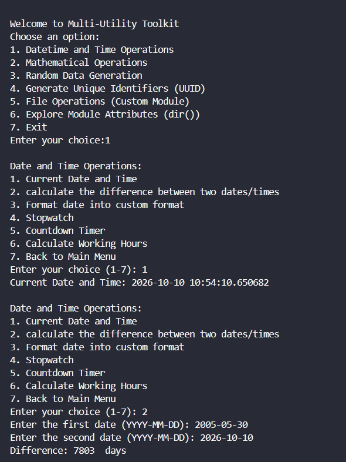 |
| **Output 1.2** | 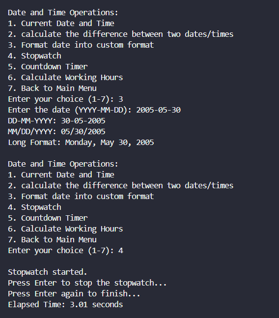 |
| **Output 1.3** | 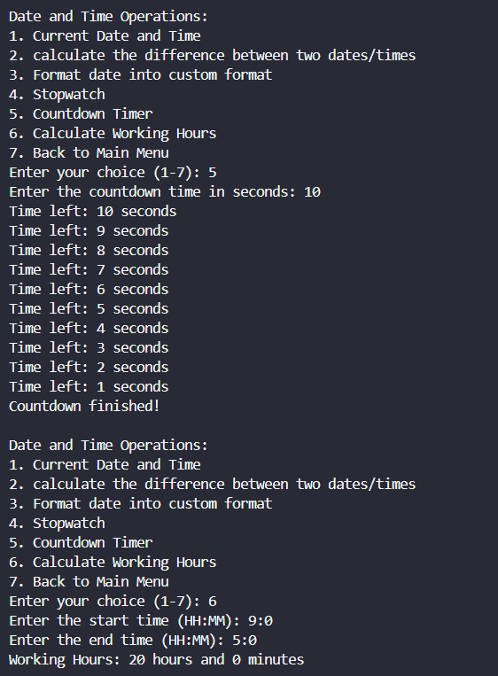 |
| **Output 2.1** | 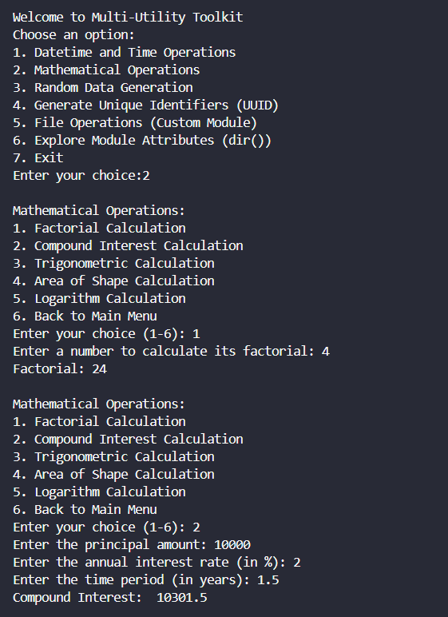 |
| **Output 2.2** | 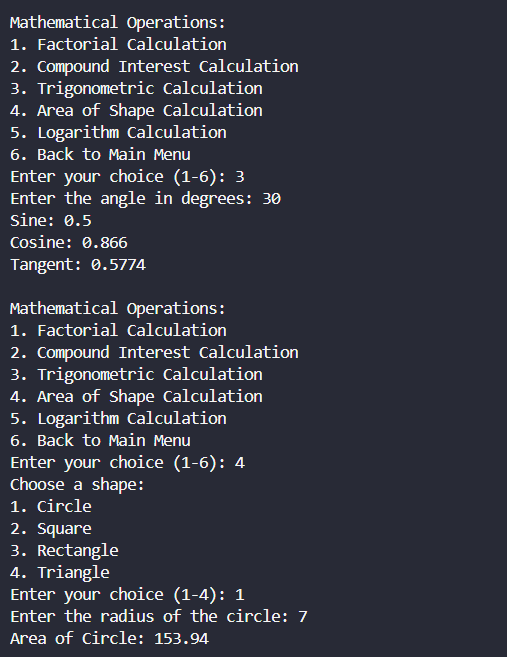 |
| **Output 2.3** | 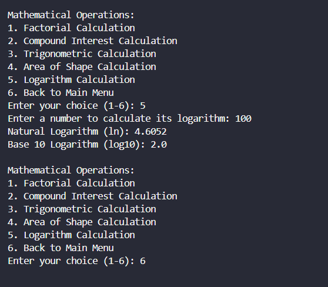 |
| **Output 3.1** | 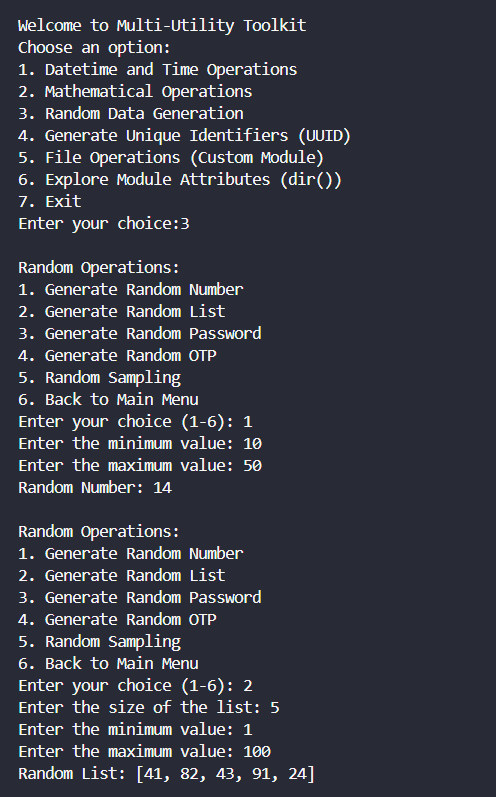 |
| **Output 3.2** | 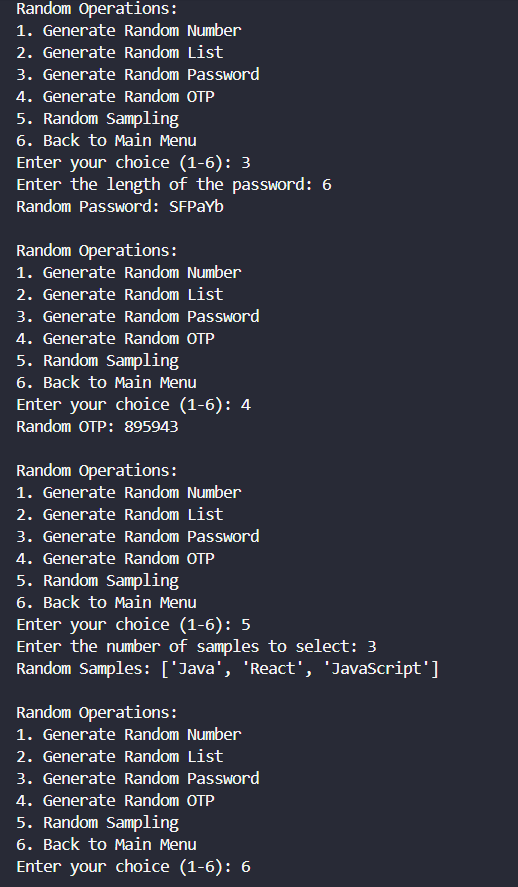 |
| **Output 4.1** | 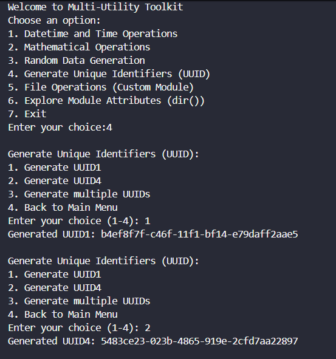 |
| **Output 4.2** | 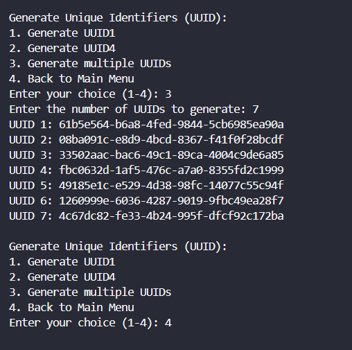 |
| **Output 5.1** | 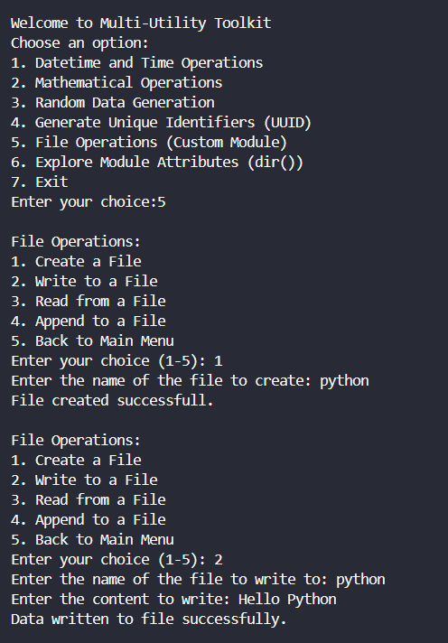 |
| **Output 5.2** | 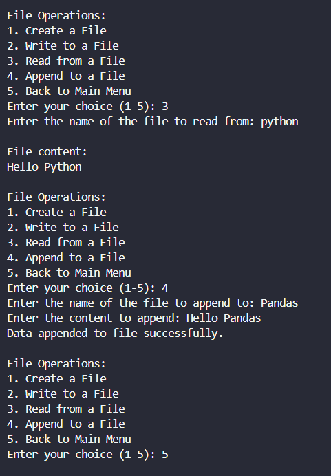 |
| **Output 6** | 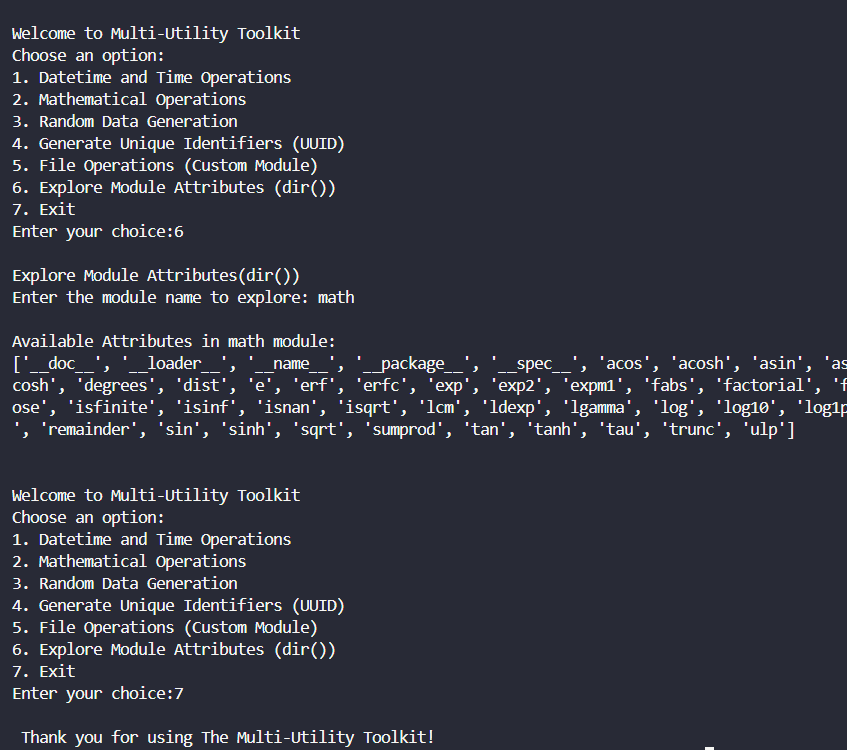 |

</div>


## 🎥 Project Demonstration

Watch the complete project demonstration video using the link below. This follows the same relative-link format as the older README.

<div align="center">

### ▶️ Watch the Project in Action

[▶️ **Open Project Demonstration Video**](assets/Project%20Demonstration.mp4)

</div>

> **Note:** For this link to work on GitHub, place the video file named `Project Demonstration.mp4` inside the project's `assets/` folder. The video itself was not included in the ZIP you uploaded, so this update adds the README link but does not add a video file.

---

## 🚀 How to Run

### 1. Install Python

Install Python 3.x if it is not already installed. Confirm the installation in a terminal:

```bash
python --version
```

On some systems, use `python3 --version`.

### 2. Open the project folder

Open the extracted `P-7 Moduler & Packager` folder in VS Code or another Python IDE.

### 3. Run the program

From the project folder, run:

```bash
python main.py
```

On macOS or Linux, you may need:

```bash
python3 main.py
```

### 4. Choose an operation

Enter a number from `1` to `7` at the main menu, then follow the prompts. To use file operations, select option `5`.

## 📦 Requirements

- Python 3.x
- No third-party Python packages are required by the code shown in this project.
- Uses Python standard-library modules: `datetime`, `time`, `math`, `random`, `string`, and `uuid`.

## ⚠️ Notes

- Enter dates in `YYYY-MM-DD` format and times in `HH:MM` format when prompted.
- File creation uses `x` mode, so it reports an error if the requested file already exists.
- File writing uses `w` mode and replaces existing content; append mode (`a`) preserves existing content and adds new data.
- The stopwatch and random-data features are basic learning demonstrations.

## 🎯 Learning Outcomes

By completing this project, learners can practise:

- Building a menu-driven console application.
- Creating and importing custom Python modules and a package.
- Separating file and mathematical operations into reusable functions.
- Using standard-library modules for date/time, mathematics, randomness, and UUIDs.
- Handling text files and common errors.
- Exploring module attributes with `dir()`.

## 🚧 Possible Future Improvements

- [ ] Add more robust input validation across all menus.
- [ ] Add clearer validation for negative values and invalid ranges.
- [ ] Improve stopwatch timing so the start and stop timestamps are measured precisely.
- [ ] Add tests for the custom modules.
- [ ] Add a configuration option for the file encoding and path.
- [ ] Add a safer, cryptographically secure password-generation option.

## 📊 Project Snapshot

| Category | Details |
|---|---|
| Project | P-7 — Modular & Packager |
| Application | Multi-Utility Toolkit |
| Language | Python 3.x |
| Application type | Menu-driven console application |
| Main entry point | `main.py` |
| Custom package | `toolkit` |
| Custom modules | `file_operations.py`, `math_operations.py` |
| Standard-library modules | `datetime`, `time`, `math`, `random`, `string`, `uuid` |
| External dependencies | None |

## 🧑‍💻 Author

**Sujal Patel**

*Python Developer / Learner*

Python • Modules & Packages • File Handling • Mathematics • Problem Solving

---

<div align="center">

### 🧰 P-7 — Modular & Packager

**Organize • Calculate • Generate • Explore**

⭐ *Explore • Learn • Code • Improve*

[⬆ Back to Top](#-p-7--modular--packager)

</div>
