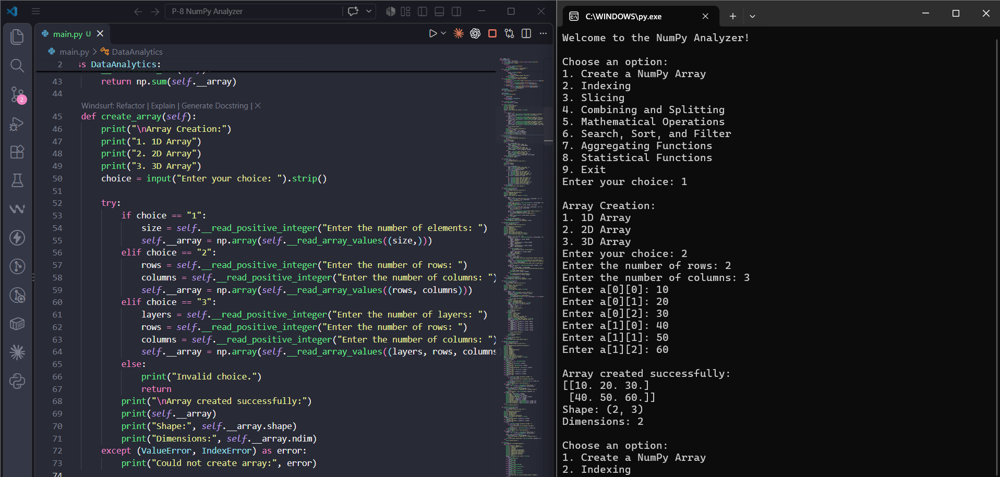
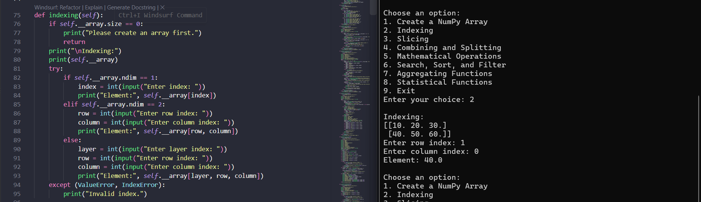
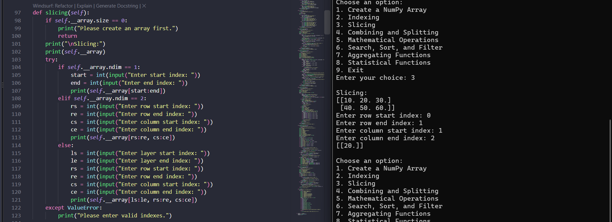
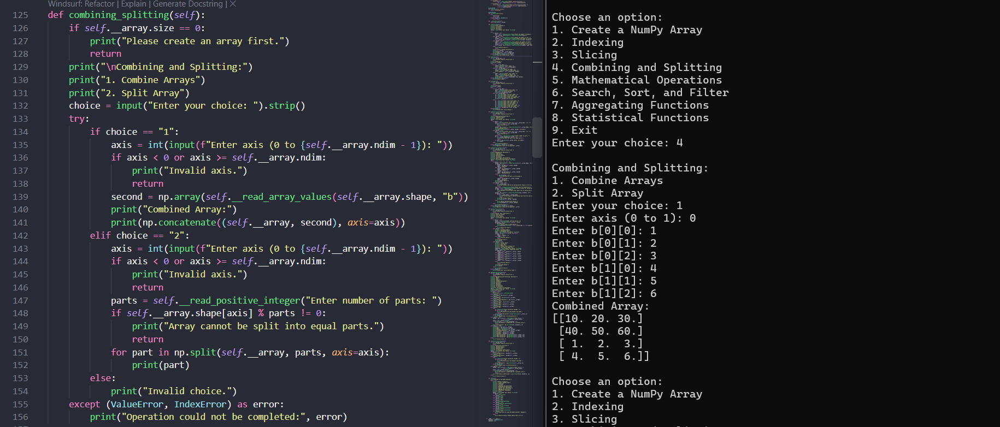
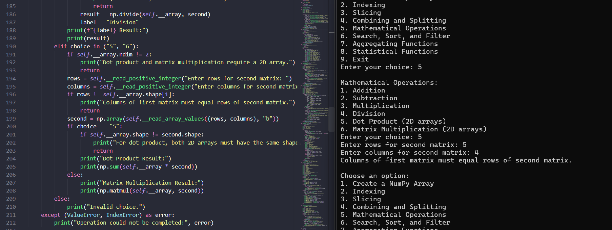
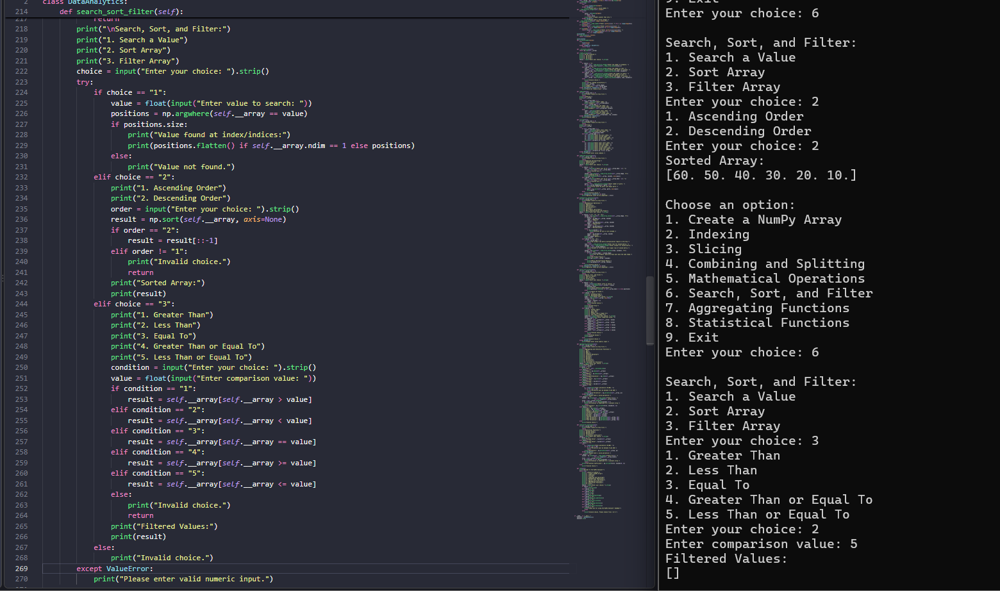
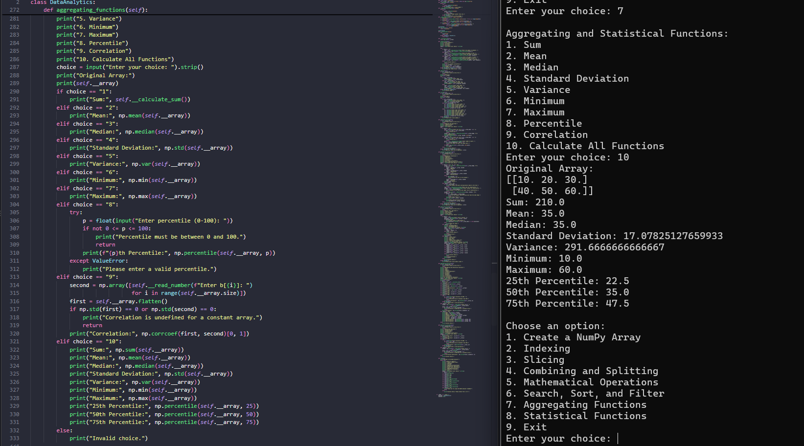
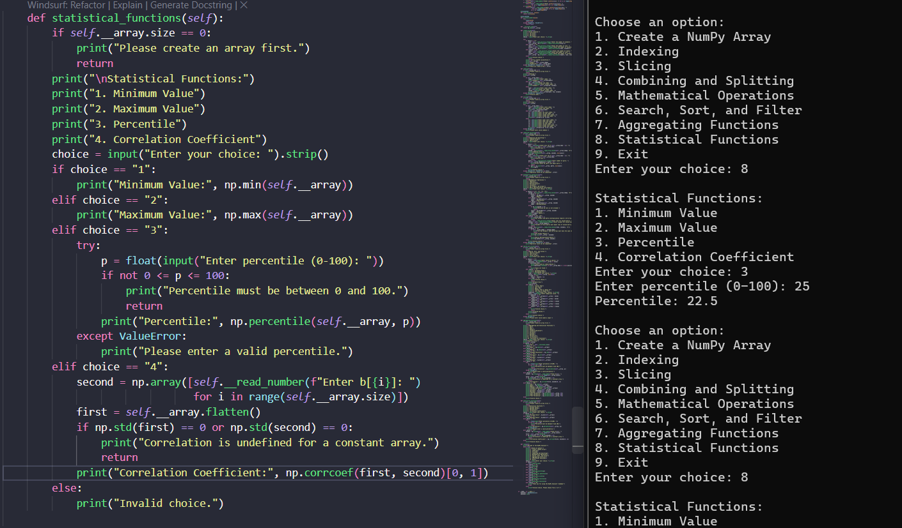

<div align="center">

# 🔢 NumPy Analyzer

### Python NumPy-Based Data Analytics Toolkit

<p>
A menu-driven Python console application built to demonstrate
<strong>NumPy arrays</strong>, <strong>array operations</strong>,
<strong>mathematical computations</strong>, <strong>statistical analysis</strong>,
and <strong>object-oriented programming</strong>.
</p>

<p>


</p>

<br>

**Create Arrays → Index → Slice → Calculate → Search → Analyze**

</div>

---

# 📌 Project Overview

**NumPy Analyzer** is a Python console-based data analytics toolkit that lets users create and work with one-dimensional (1D), two-dimensional (2D), and three-dimensional (3D) NumPy arrays.

Users can perform common array operations, mathematical calculations, searching, sorting, filtering, aggregation, and statistical analysis through an interactive menu.

The project combines NumPy functionality with object-oriented programming. The `DataAnalytics` class stores the active array, uses a constructor to initialize it, and includes private helper methods for input and internal calculations.

---

# ✨ Features

| Option | Feature | Main Concept |
|:---:|:---|:---|
| 1 | Create a NumPy Array | 1D, 2D, and 3D arrays |
| 2 | Indexing | Access an element by index |
| 3 | Slicing | Extract a range or section of an array |
| 4 | Combining and Splitting | `np.concatenate()` and `np.split()` |
| 5 | Mathematical Operations | Arithmetic, dot product, and matrix multiplication |
| 6 | Search, Sort, and Filter | Find values, sort data, and apply conditions |
| 7 | Aggregating Functions | Sum, mean, median, standard deviation, variance, and more |
| 8 | Statistical Functions | Minimum, maximum, percentile, and correlation |
| 9 | Exit | Close the application |

---

# 🖥️ Main Menu

```text
Welcome to the NumPy Analyzer!

Choose an option:
1. Create a NumPy Array
2. Indexing
3. Slicing
4. Combining and Splitting
5. Mathematical Operations
6. Search, Sort, and Filter
7. Aggregating Functions
8. Statistical Functions
9. Exit
Enter your choice:
```

The menu runs in a loop until the user selects option `9`.

---

# 🧱 Array Creation

The application supports three array dimensions:

- **1D Array** — a single sequence of values.
- **2D Array** — values organized into rows and columns.
- **3D Array** — values organized into layers, rows, and columns.

After creation, the program displays the array, its shape, and its number of dimensions.

### Example

```text
Array Creation:
1. 1D Array
2. 2D Array
3. 3D Array
Enter your choice: 1
Enter the number of elements: 4
Enter a[0]: 10
Enter a[1]: 20
Enter a[2]: 30
Enter a[3]: 40

Array created successfully:
[10. 20. 30. 40.]
Shape: (4,)
Dimensions: 1
```

*Example output is illustrative; the displayed values depend on user input.*

---

# 🔎 Indexing and Slicing

## Indexing

Access an individual array element using its index. The required indexes depend on whether the active array is 1D, 2D, or 3D.

Example for a 1D array:

```text
Indexing:
[10. 20. 30. 40.]
Enter index: 2
Element: 30.0
```

## Slicing

Extract part of an array by specifying start and end indexes. For 2D and 3D arrays, users provide ranges for the relevant dimensions.

NumPy slicing syntax is used to return the selected section without manually iterating over every element.

---

# 🔗 Combining and Splitting Arrays

The application offers two operations:

1. **Combine Arrays** — enter a second array with the same shape as the active array and join both arrays along a selected valid axis using `np.concatenate()`.
2. **Split Array** — divide the active array into a requested number of equal parts along a selected axis using `np.split()`.

The program checks the axis and whether the selected dimension can be divided into equal parts before splitting.

---

# ➗ Mathematical Operations

The mathematical operations menu supports:

| Operation | NumPy Function / Method |
|:---|:---|
| Addition | `np.add()` |
| Subtraction | `np.subtract()` |
| Multiplication | `np.multiply()` |
| Division | `np.divide()` |
| Dot Product | Element-wise multiplication followed by `np.sum()` for matching 2D arrays |
| Matrix Multiplication | `np.matmul()` |

For arithmetic operations, the program requests a second array with the same shape as the active array.

For dot product and matrix multiplication, the active array must be 2D. Matrix dimensions are checked for compatibility. Division is stopped if the second array contains zero.

---

# 🔍 Search, Sort, and Filter

## Search a Value

Search the active array for a numeric value and display the matching index or indexes using `np.argwhere()`.

## Sort Array

Sort values in ascending or descending order using `np.sort()`.

## Filter Array

Return values that match one of these comparison conditions:

- Greater than (`>`)
- Less than (`<`)
- Equal to (`==`)
- Greater than or equal to (`>=`)
- Less than or equal to (`<=`)

The user supplies the comparison value at runtime.

---

# 📊 Aggregating Functions

The aggregation menu includes the following options:

| Option | Calculation | NumPy Function |
|:---:|:---|:---|
| 1 | Sum | `np.sum()` |
| 2 | Mean | `np.mean()` |
| 3 | Median | `np.median()` |
| 4 | Standard Deviation | `np.std()` |
| 5 | Variance | `np.var()` |
| 6 | Minimum | `np.min()` |
| 7 | Maximum | `np.max()` |
| 8 | Percentile | `np.percentile()` |
| 9 | Correlation | `np.corrcoef()` |
| 10 | Calculate All Functions | Calculates a set of aggregate statistics |

The percentile input must be between `0` and `100`. For correlation, the program asks for a second set of values and checks for constant arrays, for which correlation is undefined.

---

# 📈 Statistical Functions

The separate statistical menu provides:

1. Minimum value
2. Maximum value
3. Percentile
4. Correlation coefficient

These options demonstrate how NumPy can calculate summary statistics and relationships between two sets of numeric values.

---

# 🧠 Object-Oriented Programming (OOP)

The project is organized around the `DataAnalytics` class.

### Constructor

```python
class DataAnalytics:
    def __init__(self, array=None):
        self.__array = np.array([]) if array is None else np.array(array)
```

The constructor initializes the active array. If no array is supplied, it starts with an empty NumPy array.

### Encapsulation and Private Methods

The array is stored in the private attribute `__array`. Private helper methods handle numeric input, positive-integer input, array-value input, and sum calculation.

### Class Method

```python
@classmethod
def from_values(cls, values):
    return cls(values)
```

`from_values()` creates a `DataAnalytics` instance from supplied values.

### Static Method

```python
@staticmethod
def is_valid_number(value):
    try:
        float(value)
        return True
    except (TypeError, ValueError):
        return False
```

`is_valid_number()` checks whether a value can be converted to a number.

---

# 🛡️ Input Validation and Error Handling

The application validates user input and handles common errors during interactive operations.

Examples include:

- Non-numeric input when a number is required
- Invalid menu selections
- Invalid indexes or axes
- Non-positive dimensions or number of split parts
- Percentiles outside the range `0–100`
- Division by zero
- Incompatible matrix dimensions
- Attempts to perform an operation before creating an array

When an array-dependent operation is selected before an array has been created, the program asks the user to create an array first.

---

# 🔄 Program Workflow

```text
START
  |
  v
Create DataAnalytics Object
  |
  v
Display Main Menu
  |
  v
Select an Operation
  |
  +--> Create Array
  +--> Indexing
  +--> Slicing
  +--> Combine / Split
  +--> Mathematical Operations
  +--> Search / Sort / Filter
  +--> Aggregating Functions
  +--> Statistical Functions
  |
  v
Return to Main Menu
  |
  +--> Option 9: Exit
  |
  v
END
```

---

# 📚 Python and NumPy Concepts Demonstrated

| Concept | Usage in Project |
|:---|:---|
| Class and Object | `DataAnalytics` |
| Constructor | `__init__()` |
| Encapsulation | Private array attribute `__array` |
| Private Methods | Internal input and sum helpers |
| Class Method | `from_values()` |
| Static Method | `is_valid_number()` |
| NumPy Arrays | 1D, 2D, and 3D arrays |
| Array Attributes | `shape`, `ndim`, and `size` |
| Indexing and Slicing | Accessing elements and subarrays |
| Array Combining | `np.concatenate()` |
| Array Splitting | `np.split()` |
| Arithmetic | `np.add()`, `np.subtract()`, `np.multiply()`, `np.divide()` |
| Matrix Operations | `np.matmul()` |
| Search | `np.argwhere()` |
| Sorting | `np.sort()` |
| Filtering | Boolean indexing |
| Aggregation | Sum, mean, median, variance, and standard deviation |
| Statistics | Minimum, maximum, percentile, and correlation |
| Input Validation | `try-except` and conditional checks |
| Loops | Repeated input and menu handling |

---

# 📂 Project Structure

```text
📦 P-8 NumPy Analyzer
│
├── 🐍 main.py
├── 📘 README.md
│
└── 📂 assets
    ├── 🖼️ Output1.png
    ├── 🖼️ Output2.png
    ├── 🖼️ Output3.png
    ├── 🖼️ Output4.png
    ├── 🖼️ Output5.png
    ├── 🖼️ Output6.png
    ├── 🖼️ Output7.png
    ├── 🖼️ Output8.png
    └── 🎥 Project Demonstration.mp4
```

---

# 📸 Output Gallery

<div align="center">

<table width="100%">
<tr>
<td width="50%" valign="top" align="center">

### 🖥️ Output 1

<a href="assets/Output1.png">

</a>

</td>
<td width="50%" valign="top" align="center">

### 🖥️ Output 2

<a href="assets/Output2.png">

</a>

</td>
</tr>
<tr>
<td width="50%" valign="top" align="center">

### 🖥️ Output 3

<a href="assets/Output3.png">

</a>

</td>
<td width="50%" valign="top" align="center">

### 🖥️ Output 4

<a href="assets/Output4.png">

</a>

</td>
</tr>
<tr>
<td width="50%" valign="top" align="center">

### 🖥️ Output 5

<a href="assets/Output5.png">

</a>

</td>
<td width="50%" valign="top" align="center">

### 🖥️ Output 6

<a href="assets/Output6.png">

</a>

</td>
</tr>
<tr>
<td width="50%" valign="top" align="center">

### 🖥️ Output 7

<a href="assets/Output7.png">

</a>

</td>
<td width="50%" valign="top" align="center">

### 🖥️ Output 8

<a href="assets/Output8.png">

</a>

</td>
</tr>
</table>

</div>

---

# 🎥 Project Demonstration

<div align="center">

## ▶️ See the NumPy Analyzer in Action

The project demonstration video is included in the `assets` folder.

**[▶️ Open Project Demonstration Video](assets/Project%20Demonstration.mp4)**

</div>

> [!TIP]
> If GitHub does not preview the MP4 directly, click the link above to open the video.

---

# 🚀 How to Run

### 1. Install Python

Install Python 3.x and verify the installation:

```bash
python --version
```

Depending on your system, you may need to use `python3 --version`.

### 2. Install NumPy

Install the required external package:

```bash
python -m pip install numpy
```

If your system uses `python3`, run:

```bash
python3 -m pip install numpy
```

### 3. Open the Project Folder

Open the `P-8 NumPy Analyzer` folder in VS Code, PyCharm, IDLE, or another Python IDE.

### 4. Run the Program

```bash
python main.py
```

Or, where required:

```bash
python3 main.py
```

### 5. Choose an Operation

Select an option from the menu and follow the prompts to create an array and perform operations.

---

# 📦 Requirements

| Requirement | Details |
|:---|:---|
| Language | Python 3.x |
| External Library | NumPy |
| Application Type | Console application |
| Input | Numeric values entered by the user |
| Storage | In-memory NumPy arrays |
| Database | None |
| API | None |
| Framework | None |

Install the required library with:

```bash
python -m pip install numpy
```

---

# 🎯 Learning Outcomes

By completing this project, users practice:

- Creating and manipulating multidimensional NumPy arrays
- Understanding array shape, size, and dimensions
- Applying indexing and slicing
- Combining and splitting arrays along axes
- Performing arithmetic and matrix calculations
- Searching, sorting, and filtering values
- Calculating descriptive statistics and percentiles
- Finding correlation coefficients
- Applying classes, constructors, encapsulation, class methods, and static methods
- Validating input and handling common runtime errors
- Building a menu-driven Python console application

---

# 📊 Project Snapshot

<div align="center">

| Category | Details |
|:---|:---|
| 🏷️ Project | NumPy Analyzer |
| 🐍 Language | Python 3.x |
| 🔢 Core Library | NumPy |
| 💻 Type | Console Application |
| 🧱 Main Class | `DataAnalytics` |
| 📐 Array Types | 1D, 2D, and 3D |
| ➗ Mathematical Operations | Arithmetic, dot product, matrix multiplication |
| 📊 Analysis | Aggregation and statistical functions |
| 🛡️ Input Validation | Implemented |
| 🖼️ Output Images | 8 |
| 🎥 Demonstration | Included |
| 📦 External Package | NumPy |

</div>

---

# 🧑‍💻 Author

<div align="center">

## **Sujal Patel**

### Python Developer / Learner

**Python • NumPy • OOP • Data Analytics • Problem Solving**

This project was developed as a practical exercise in NumPy array operations, mathematical computations, statistical analysis, and object-oriented programming.

</div>

---

# 📄 License

This project is created for **educational and learning purposes**.

---

<div align="center">

# 🔢 NumPy Analyzer

### **Create • Calculate • Search • Analyze**

<br>

🐍 **Developed by Sujal Patel**

<br>

⭐ **Explore • Learn • Code • Improve**

<br><br>

<a href="#-numpy-analyzer">⬆ Back to Top</a>

</div>
