<div align="center">

# 📊 Pandas Analyzer & Data Visualization

### Python-Based Sales Data Analysis Toolkit

A menu-driven data analysis project built with **Pandas, NumPy, Matplotlib, Seaborn, and Object-Oriented Programming (OOP)**. Load sales data from CSV files, clean and analyze records, calculate statistics, create pivot tables, and generate visualizations to support data-driven decisions.

<p>
  
  
  
  
  
  
</p>

**Load → Clean → Explore → Analyze → Visualize → Export**

</div>

---

## 📌 Project Overview

**Pandas Analyzer & Data Visualization** is a Python project developed in Jupyter Notebook. It uses a `SalesDataAnalyzer` class to manage a sales dataset and provide interactive operations for data exploration, cleaning, transformation, statistical analysis, and visualization.

The notebook loads a CSV file, displays dataset information, handles missing values and duplicates, supports combining and splitting data, and creates charts using Matplotlib and Seaborn. A menu-driven interface lets users choose the operation they want to perform.

## ✨ Features

| Option | Feature | Description |
|:---:|---|---|
| 1 | Load Dataset | Read a sales dataset from a CSV file |
| 2 | Explore Data | Display head, tail, column names, data types, shape, and dataset information |
| 3 | Clean Data | Inspect missing values, fill missing values, and remove duplicate rows |
| 4 | Mathematical Operations | Add, subtract, multiply, divide, or square values in a numeric column |
| 5 | Combine Data | Concatenate rows or merge a second CSV file |
| 6 | Split Data | Group records by a selected column and optionally save groups to CSV |
| 7 | Search, Sort, and Filter | Search text, filter numeric values, sort records, and match exact values |
| 8 | Aggregation Functions | Calculate sum, mean, median, minimum, maximum, count, and standard deviation |
| 9 | Statistical Analysis | View descriptive statistics, variance, standard deviation, and percentiles |
| 10 | Pivot Table | Summarize values by one or two categorical columns |
| 11 | NumPy Operations | Convert numeric columns to arrays and demonstrate indexing, slicing, and calculations |
| 12 | Data Visualization | Generate Matplotlib and Seaborn charts |
| 13 | Save Visualization | Save the most recently generated chart |
| 14 | Export Report | Export the dataset or numeric descriptive statistics to CSV |
| 15 | Exit | Close the menu loop |

## 🧰 Technologies Used

- **Python 3** — core programming language
- **Pandas** — CSV loading, cleaning, filtering, grouping, aggregation, and pivot tables
- **NumPy** — array conversion, indexing, slicing, and numeric calculations
- **Matplotlib** — chart creation and saving
- **Seaborn** — statistical charts and styling
- **Jupyter Notebook** — step-by-step development and testing

## 📂 Project Structure

```text
📦 P-9 Pandas Analyzer & Data Visualization
│
├── 📓 main.ipynb
├── 📄 sales_data.csv
├── 📄 second_sales_data.csv
├── 📄 README.md
│
└── 📂 assets
    ├── 🖼️ Output1.png
    ├── 🖼️ Output2.png
    ├── 🖼️ Output3.png
    ├── 🖼️ Output4.png
    ├── 🖼️ Output5.png
    ├── 🖼️ Output6.png
    ├── 🖼️ Output7.png
    ├── 🖼️ Output8.png
    ├── 🖼️ Output9.png
    ├── 🖼️ Output10.png
    ├── 🖼️ Output11.png
    ├── 🖼️ Output12.png
    └── 🖼️ Output13.png
```

> The `cleaned_sales` item is also present in the supplied project archive. Keep it if it is part of your own workflow.

## 🚀 How to Run the Project

### 1. Install Python

Install Python 3.x and check the installation:

```bash
python --version
```

### 2. Install Required Libraries

Run this in a terminal:

```bash
python -m pip install pandas numpy matplotlib seaborn jupyter
```

Or run the following in a Jupyter Notebook cell:

```python
%pip install pandas numpy matplotlib seaborn
```

### 3. Open the Project

Open the project folder in Jupyter Notebook or JupyterLab and open `main.ipynb`.

### 4. Check the CSV Filename

The notebook uses this setting:

```python
CSV_FILE = "sales_data.csv"
```

Keep `sales_data.csv` in the same folder as `main.ipynb`, or change the variable to your actual CSV filename.

The project archive includes `second_sales_data.csv` for testing the combine/merge feature. Keep both CSV files in the project folder if you want to try that option.

### 5. Run the Notebook

Run all cells from top to bottom. The final cell loads the CSV and starts the menu-driven program.

## 🖥️ Main Menu

The notebook menu provides these choices:

```text
1. Load Dataset
2. Explore Data
3. Clean Data
4. Mathematical Operations
5. Combine with Another CSV
6. Split Data
7. Search, Sort, Filter
8. Aggregation Functions
9. Statistical Analysis
10. Create Pivot Table
11. NumPy Operations
12. Data Visualization
13. Save Visualization
14. Export Dataset or Report
15. Exit
```

Follow the prompts shown after selecting an option. Column names are requested at runtime so the operations can be adapted to the columns in your CSV.

## 🧹 Data Cleaning

The cleaning operation:
- Displays missing-value counts for each column.
- Fills missing numeric values with the column mean when available.
- Fills missing text values with the most frequent value (mode) when available.
- Removes duplicate rows.
- Displays the remaining missing values and duplicates.

**Tip:** Run data cleaning before performing analysis if your dataset contains missing values or duplicates. Cleaning changes the active DataFrame in memory; export the cleaned dataset if you want to keep the result as a file.

## 📊 Analysis and Statistics

The project includes:
- Numeric-column mathematical operations
- Search by text and exact value
- Numeric filtering and sorting
- Grouped aggregation by a selected column
- Descriptive statistics using `describe()`
- Standard deviation using `std()`
- Variance using `var()`
- Percentiles using `quantile()`
- Pivot tables using `pandas.pivot_table()`
- NumPy array conversion, indexing, slicing, and calculations

## 📈 Visualizations

The visualization menu supports:

| Chart | Purpose |
|---|---|
| Bar Plot | Compare a numeric measure across categories |
| Line Plot | Show values or trends across rows or a selected x-axis |
| Scatter Plot | Examine the relationship between two numeric columns |
| Pie Chart | Show the proportions of categories |
| Histogram | View the distribution of a numeric column |
| Stack Plot | Display grouped numeric values as a stacked area-style plot |
| Seaborn Box Plot | Inspect spread and potential outliers |
| Seaborn Heatmap | Visualize correlations between numeric columns |
| Multiple Subplots | Display distributions of several numeric columns in one figure |

Charts can be saved as PNG, JPG, JPEG, or PDF files using the save-visualization option.

## 🧱 Object-Oriented Programming

The project uses the `SalesDataAnalyzer` class to encapsulate the dataset and related operations.

| OOP / Programming Concept | Use in Project |
|---|---|
| Class and Object | `SalesDataAnalyzer` and `analyzer` |
| Constructor | `__init__()` initializes the DataFrame and optional file path |
| Destructor | `__del__()` is included; no special cleanup is required |
| Encapsulation | Data and analysis methods are grouped in one class |
| Methods | Loading, cleaning, searching, analysis, visualization, and exporting |
| Exception Handling | Handles missing files and common loading/export errors |
| Loops and Conditions | Menu navigation and operation choices |

## 📷 Output Gallery

The output screenshots are stored in the `assets` folder. Click a screenshot to view it.

<div align="center">

| Output 1 | Output 2 |
|:---:|:---:|
| [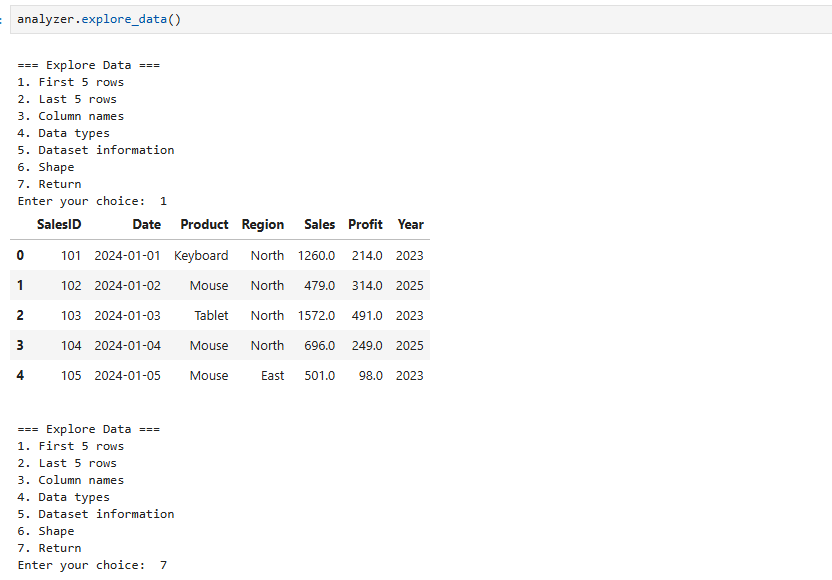](assets/Output1.png) | [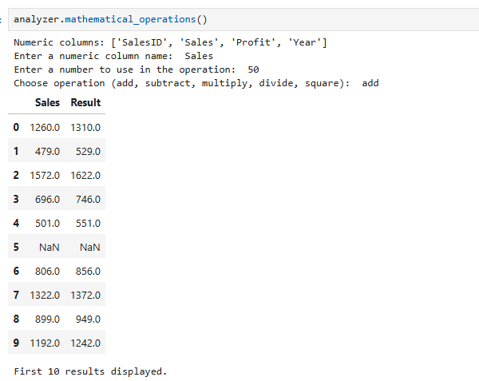](assets/Output2.png) |
| [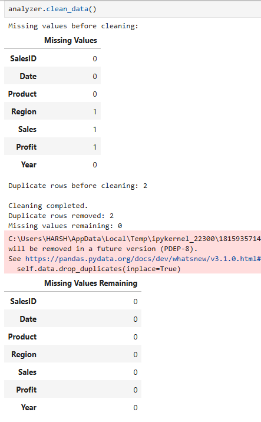](assets/Output3.png) | [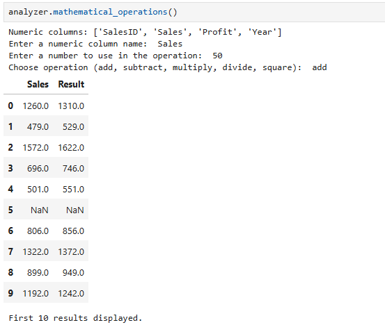](assets/Output4.png) |
| [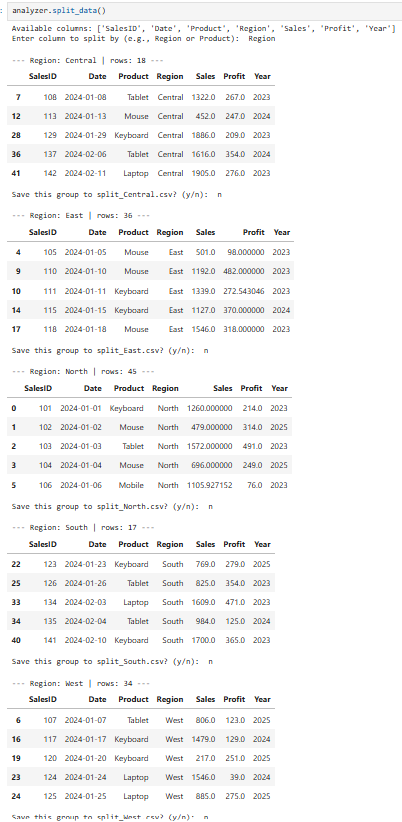](assets/Output5.png) | [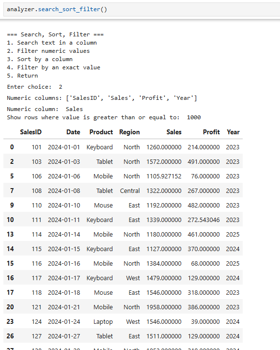](assets/Output6.png) |
| [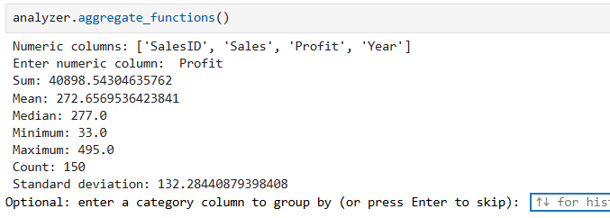](assets/Output7.png) | [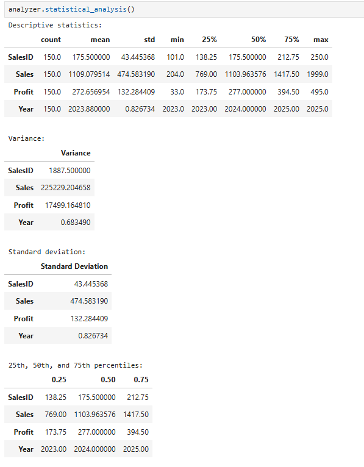](assets/Output8.png) |
| [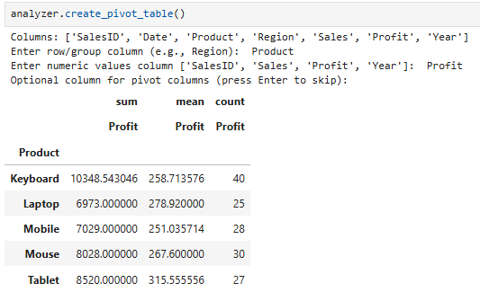](assets/Output9.png) | [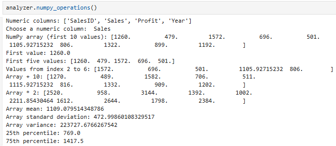](assets/Output10.png) |
| [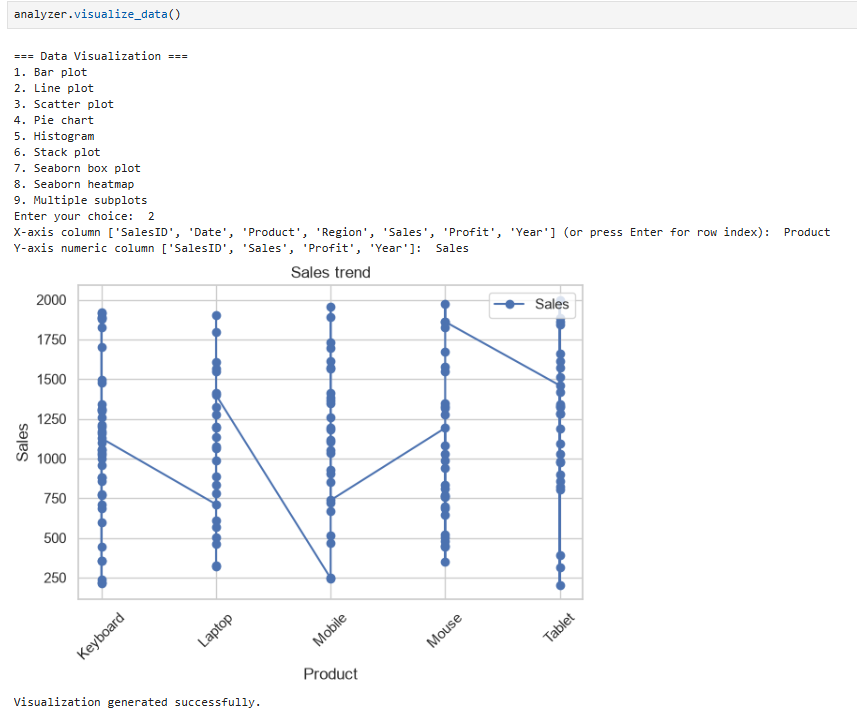](assets/Output11.png) | [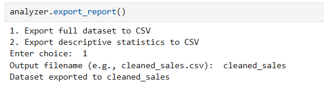](assets/Output12.png) |

[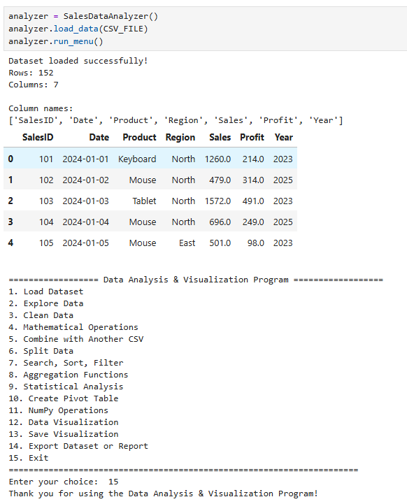](assets/Output13.png)

</div>

## 📤 Exporting Results

The export option supports:
1. Saving the active dataset to a CSV file.
2. Saving descriptive statistics for numeric columns to a CSV file.

The visualization option separately saves the most recently generated chart.

## 🎯 Learning Outcomes

By completing this project, students practice:

- Reading and working with real-world CSV data
- Exploring and cleaning tabular datasets
- Handling missing values and duplicate records
- Performing mathematical and statistical calculations
- Filtering, sorting, searching, grouping, and combining DataFrames
- Using NumPy arrays with Pandas
- Building pivot tables for summarization
- Creating and customizing charts with Matplotlib and Seaborn
- Saving charts and exporting analysis results
- Applying OOP, loops, conditions, and exception handling in Python

## 📌 Project Snapshot

| Category | Details |
|---|---|
| Project | Pandas Analyzer & Data Visualization |
| Language | Python 3.x |
| Main Class | `SalesDataAnalyzer` |
| Data Format | CSV |
| Libraries | Pandas, NumPy, Matplotlib, Seaborn |
| Development Environment | Jupyter Notebook |
| Analysis | Cleaning, aggregation, statistics, pivot tables |
| Visualizations | Bar, line, scatter, pie, histogram, stack plot, box plot, heatmap, subplots |
| Export Formats | CSV for data/reports; PNG, JPG/JPEG, PDF for charts |

## 👨‍💻 Author

<div align="center">

### **Sujal Patel**

**Python • Pandas • NumPy • Data Analysis • Data Visualization**

This project was developed as a practical exercise in data manipulation, statistical analysis, visualization, and object-oriented programming.

</div>

---

<div align="center">

### 📊 Pandas Analyzer & Data Visualization

**Explore • Clean • Analyze • Visualize**

[⬆ Back to Top](#-pandas-analyzer--data-visualization)

</div>
