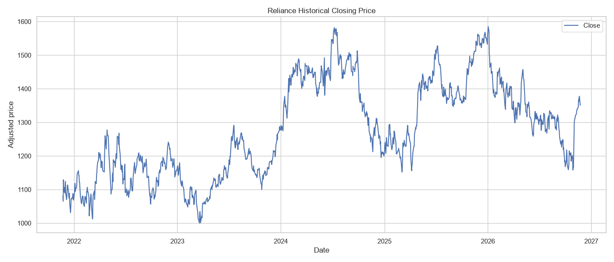
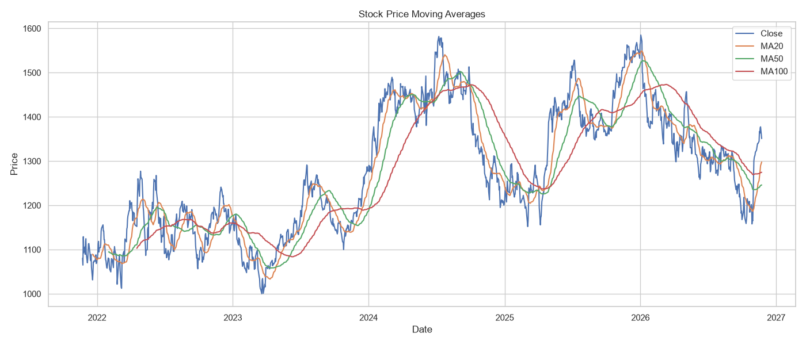
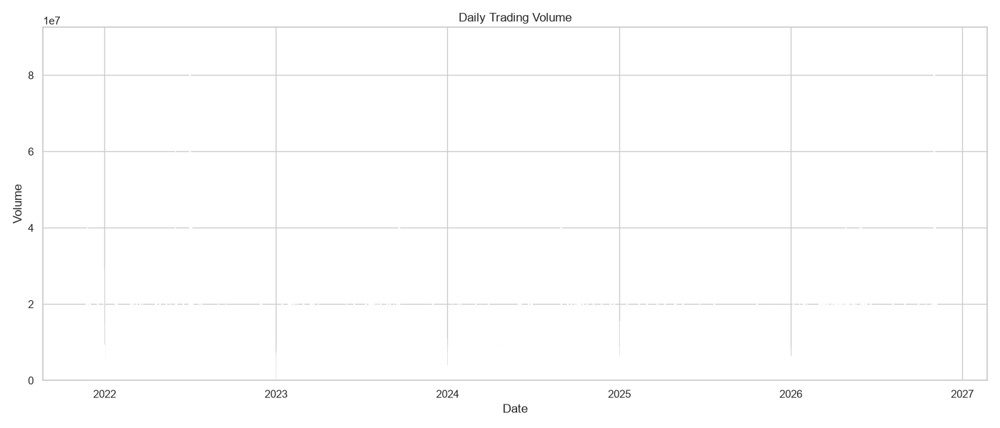
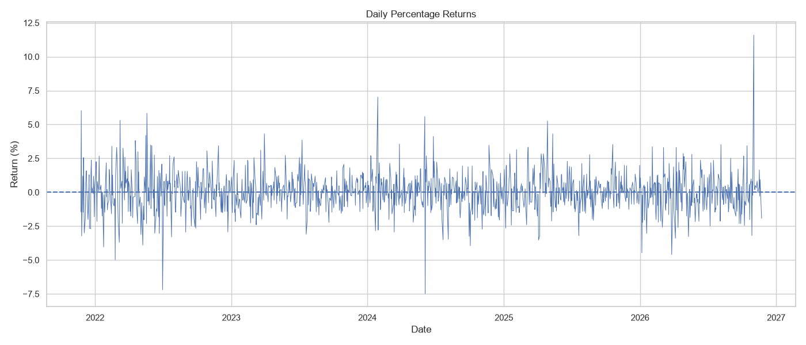
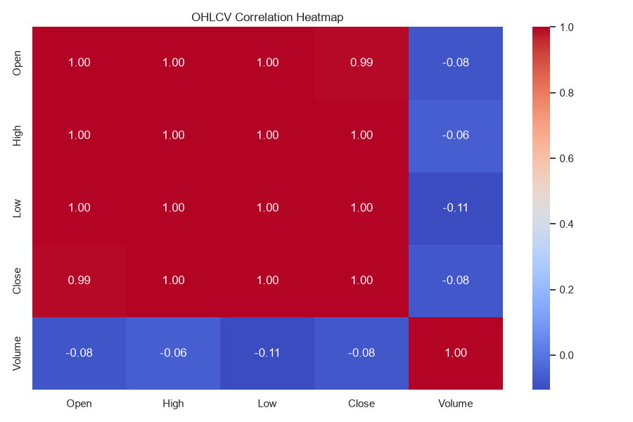
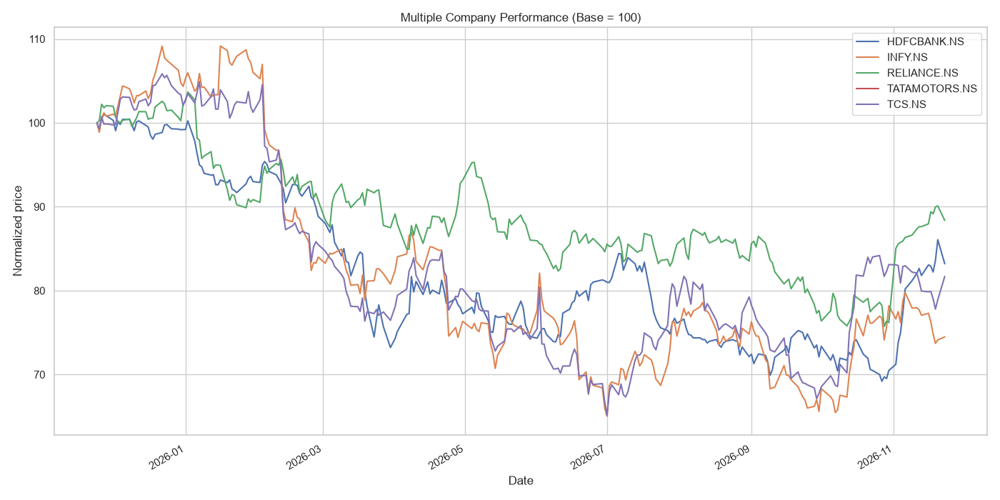
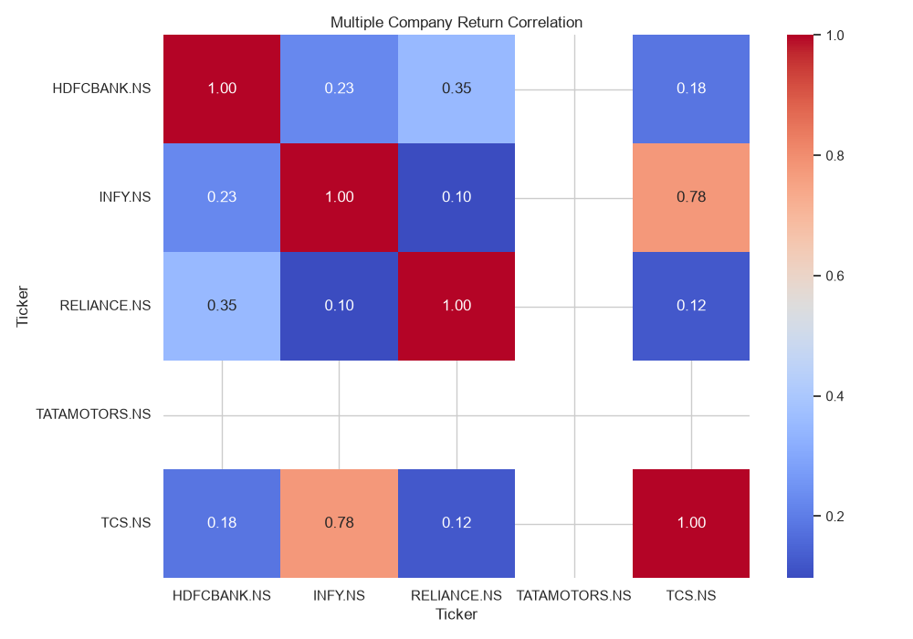
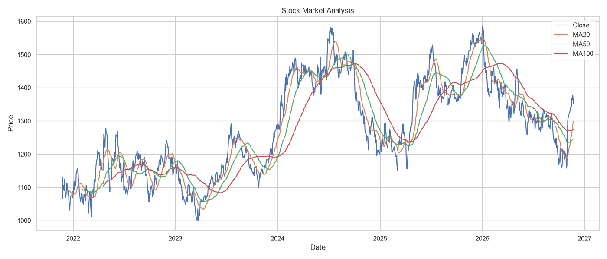

<div align="center">

# 📈 Stock Market Analysis and Visualization System

### Python-Based Stock Price Analysis Toolkit

A Jupyter Notebook project that analyzes historical stock market data using **Python, Pandas, NumPy, Matplotlib, Seaborn, and yfinance**. Explore Reliance stock prices, calculate daily returns and moving averages, compare multiple companies, visualize market trends, and export analysis reports.

<p>
  
  
  
  
  
  
  
</p>

**Collect → Clean → Analyze → Compare → Visualize → Export**

</div>

---

## 📌 Project Overview

**Stock Market Analysis and Visualization System (Project 5)** is a Python project developed using Jupyter Notebook. It studies historical stock price information and demonstrates how data analysis techniques can be used to understand price movement, trading volume, daily returns, moving averages, and relationships between multiple companies.

The primary stock used in the notebook is **Reliance Industries (`RELIANCE.NS`)**. The project also compares five Indian stock symbols:

- `RELIANCE.NS` — Reliance Industries
- `TCS.NS` — Tata Consultancy Services
- `INFY.NS` — Infosys
- `HDFCBANK.NS` — HDFC Bank
- `TATAMOTORS.NS` — Tata Motors

The notebook first attempts to download market data from Yahoo Finance. If the download is unavailable, it uses the included CSV practice datasets.

## ✨ Features

| No. | Feature | Description |
|:---:|---|---|
| 1 | Stock Data Collection | Download historical Reliance stock data using `yfinance` |
| 2 | Multiple Dataset Loading | Load Yahoo Finance-format and multi-company CSV datasets |
| 3 | Data Exploration | Display sample records, shape, columns, data types, and dataset information |
| 4 | Data Quality Check | Check missing values and duplicate records |
| 5 | Data Cleaning | Convert dates and numeric columns, sort records, remove duplicate dates, and handle invalid values |
| 6 | Price Analysis | Calculate highest, lowest, and average stock prices |
| 7 | Daily Returns | Calculate daily price changes and percentage returns |
| 8 | NumPy Analysis | Calculate mean, median, standard deviation, minimum, maximum, and total price change |
| 9 | Moving Averages | Calculate 20-day, 50-day, and 100-day moving averages |
| 10 | Volatility | Calculate rolling 20-day volatility |
| 11 | Company Comparison | Compare normalized price performance for multiple companies |
| 12 | Correlation Analysis | Study relationships between stock prices and company daily returns |
| 13 | Data Visualization | Create stock price, moving average, volume, returns, and correlation charts |
| 14 | Report Export | Save complete analysis and company summary reports as CSV files |
| 15 | Basic Testing | Check whether datasets, calculations, charts, and reports were created successfully |

## 🧰 Technologies Used

- **Python 3** — main programming language
- **Pandas** — loading, cleaning, transforming, and analyzing stock datasets
- **NumPy** — numerical calculations and array operations
- **Matplotlib** — stock market charts and plots
- **Seaborn** — heatmaps and statistical visualizations
- **yfinance** — downloading historical stock market data from Yahoo Finance
- **Jupyter Notebook** — project development and execution environment

## 📂 Project Structure

```text
📦 Stock_Market_Analysis_Project
│
├── 📓 Stock_Market_Analysis.ipynb
├── 📄 README.md
│
├── 📂 Dataset
│   ├── 📄 yahoo_stock_data.csv
│   ├── 📄 yahoo_stock_data_cleaned.csv
│   ├── 📄 yahoo_format_SAMPLE_RELIANCE.csv
│   ├── 📄 kaggle_format_SAMPLE_multiple_stocks.csv
│   └── 📄 kaggle_stock_data_cleaned.csv
│
├── 📂 Output
│   ├── 🖼️ stock_price.png
│   ├── 🖼️ moving_average.png
│   ├── 🖼️ trading_volume.png
│   ├── 🖼️ daily_returns.png
│   ├── 🖼️ correlation_heatmap.png
│   ├── 🖼️ multiple_company_comparison.png
│   ├── 🖼️ multiple_company_correlation.png
│   ├── 🖼️ function_stock_plot.png
│   └── 🎥 Project Demonstration.mp4
│
└── 📂 Reports
    ├── 📄 stock_analysis_report.csv
    ├── 📄 reliance_complete_analysis.csv
    └── 📄 multiple_company_summary.csv
```

*The `.ipynb_checkpoints` folder may also be present. It is an automatically generated Jupyter Notebook folder and is not required to run the project.*

## 🚀 How to Run the Project

### 1. Install Python

Install Python 3.x. Check that Python is available:

```bash
python --version
```

### 2. Extract the Project

Extract `Stock_Market_Analysis_Project.zip` and open the extracted project folder in VS Code or a terminal.

### 3. Install Required Libraries

Run this command:

```bash
python -m pip install pandas numpy matplotlib seaborn yfinance jupyter
```

### 4. Start Jupyter Notebook

```bash
jupyter notebook
```

### 5. Open the Notebook

Open:

```text
Stock_Market_Analysis.ipynb
```

### 6. Run the Cells

Run the notebook cells from top to bottom. The notebook creates the `Dataset`, `Output`, and `Reports` folders when needed, loads the datasets, performs analysis, generates charts, and exports reports.

## 📊 Analysis Performed

### Stock Price Analysis

The project calculates:

- Highest recorded high price
- Lowest recorded low price
- Average closing price
- Maximum trading volume
- Average trading volume
- Dates of the highest high and lowest low prices

### Daily Return Analysis

The notebook calculates daily price change and percentage change:

```python
yahoo_analysis["Daily_Change"] = yahoo_analysis["Close"].diff()
yahoo_analysis["Percentage_Change"] = yahoo_analysis["Close"].pct_change() * 100
```

### Moving Average Analysis

The notebook calculates:

- **MA20** — 20-day moving average
- **MA50** — 50-day moving average
- **MA100** — 100-day moving average

It also calculates rolling 20-day volatility and compares the latest available MA20 and MA50 values.

### Multiple Company Analysis

The project compares the adjusted closing prices of five companies. Prices are normalized to a base value of 100 to make their relative performance easier to compare.

It also calculates:

- Average daily return (%)
- Annualized volatility (%)
- Correlation between company daily returns

## 📈 Visualizations

| Chart | Purpose |
|---|---|
| Stock Price | Shows Reliance historical closing prices |
| Moving Average | Compares closing price with MA20, MA50, and MA100 |
| Trading Volume | Displays daily trading volume |
| Daily Returns | Shows daily percentage returns |
| Correlation Heatmap | Displays correlation among OHLCV columns |
| Multiple Company Comparison | Compares normalized performance of five companies |
| Multiple Company Correlation | Displays correlation between company daily returns |
| Function Stock Plot | Shows stock price and moving averages using a reusable function |

All generated charts are saved as PNG files inside the `Output` folder.

## 📷 Output Gallery

The following charts are included in the `Output` folder.

<div align="center">

| Stock Price | Moving Average |
|:---:|:---:|
|  |  |

| Trading Volume | Daily Returns |
|:---:|:---:|
|  |  |

| Correlation Heatmap | Multiple Company Comparison |
|:---:|:---:|
|  |  |

| Multiple Company Correlation | Function Stock Plot |
|:---:|:---:|
|  |  |

</div>

## 📤 Reports and Exported Files

The project exports the following CSV reports into the `Reports` folder:

| File | Description |
|---|---|
| `stock_analysis_report.csv` | Reliance analysis data, including calculated analysis columns |
| `reliance_complete_analysis.csv` | Complete Reliance dataset with daily returns, moving averages, and volatility |
| `multiple_company_summary.csv` | Average daily return and annualized volatility summary for the selected companies |

Cleaned datasets are saved in the `Dataset` folder.

## 🧪 Project Testing

The notebook includes simple checks for:

- Yahoo-format dataset loaded
- Multi-company dataset loaded
- Cleaned Yahoo data available
- Moving average calculated
- Daily return calculated
- Analysis report exported
- Stock price chart created

The notebook prints `PASS` or `FAIL` for each check and displays the total number of passed tests.

## 🗃️ Dataset Information and Data Notice

The project includes CSV files for practice and fallback use:

- `yahoo_format_SAMPLE_RELIANCE.csv` — sample single-company OHLCV data
- `kaggle_format_SAMPLE_multiple_stocks.csv` — sample OHLCV data for multiple stock symbols
- `yahoo_stock_data.csv` and the cleaned CSV files — data files included in the project archive

**Important:** The included sample CSV datasets are synthetic practice data, not verified historical market prices. The notebook attempts to download current historical data for `RELIANCE.NS` and the five-company comparison from Yahoo Finance. If the download is unavailable, it falls back to the included sample data. Therefore, check the printed data-source message before interpreting results.

To use your own multi-company CSV dataset, place it at:

```text
Dataset/kaggle_stock_data.csv
```

The expected columns are:

```text
Date, Symbol, Open, High, Low, Close, Volume
```

## 🎯 Learning Outcomes

By completing this project, students practice:

- Collecting historical stock data with Python
- Reading and exploring CSV datasets
- Cleaning date, price, and volume columns
- Handling missing and duplicate records
- Calculating daily price changes and percentage returns
- Applying NumPy statistical calculations
- Calculating moving averages and rolling volatility
- Comparing the performance of multiple companies
- Understanding correlation matrices
- Creating charts using Matplotlib and Seaborn
- Exporting analysis results to CSV
- Organizing a data analysis project in Jupyter Notebook

## 📌 Project Snapshot

| Category | Details |
|---|---|
| Project | Stock Market Analysis and Visualization System |
| Project Number | Project 5 |
| Language | Python 3.x |
| Main Notebook | `Stock_Market_Analysis.ipynb` |
| Main Stock | Reliance Industries (`RELIANCE.NS`) |
| Other Companies | TCS, Infosys, HDFC Bank, Tata Motors |
| Data Format | CSV |
| Libraries | Pandas, NumPy, Matplotlib, Seaborn, yfinance |
| Environment | Jupyter Notebook |
| Analysis | Price, daily returns, moving averages, volatility, company comparison, correlation |
| Output | PNG charts and CSV reports |

## 👨‍💻 Author

<div align="center">

### **Sujal Patel**

**Python • Pandas • NumPy • Stock Market Analysis • Data Visualization**

This project was developed as a practical exercise in financial data analysis, numerical calculations, and data visualization using Python.

</div>

---

<div align="center">

### 📈 Stock Market Analysis and Visualization System

**Collect • Analyze • Compare • Visualize**

[⬆ Back to Top](#-stock-market-analysis-and-visualization-system)

</div>

> **Disclaimer:** This project is for educational purposes only. It does not provide financial advice or stock-buy/sell recommendations. Market data availability and accuracy depend on the selected data source.
